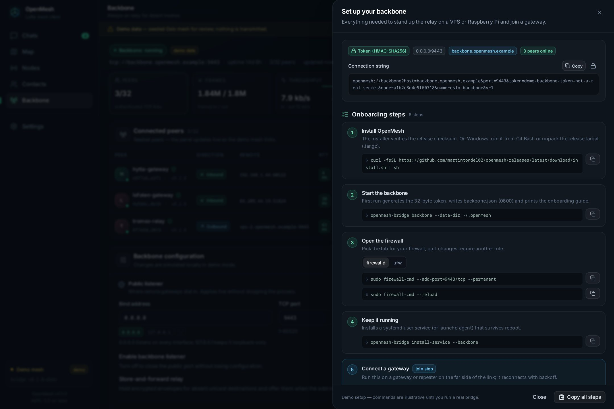

<div align="center">

# OpenMesh

**Encrypted mesh messaging over LoRa — text, images and voice notes.**
No accounts. No cell towers. No cloud. Just radios, repeaters and your people.

[](https://github.com/martintondel02/openmesh/actions/workflows/ci.yml)
[](LICENSE)
[](docs/architecture/PROTOCOL.md)
[](docs/ROADMAP.md)
[](rust-toolchain.toml)


**Docs:** [Architecture](docs/architecture/ARCHITECTURE.md) ·
[Protocol spec](docs/architecture/PROTOCOL.md) ·
[Bridge API](docs/architecture/WEBSOCKET-API.md) ·
[Hardware](docs/hardware/boards.md) ·
[Roadmap](docs/ROADMAP.md)

</div>

---

## What is OpenMesh?

OpenMesh is a from-scratch alternative to Meshtastic, built around two things the existing LoRa
mesh ecosystem does badly: **sending pictures and voice notes** over links that carry a few
hundred bytes per second, and **clients that people actually enjoy using**.

It is a complete stack: a new encrypted mesh protocol (**OMP/1**), firmware for real off-the-shelf
LoRa boards, repeater nodes that extend range and store messages for people who are offline, a
local bridge daemon, and web/desktop/Android clients with chat, group chats, a live map, location
sharing and node telemetry.

```
       phones · laptops · tablets
              │  WebSocket / USB / BLE
      ┌───────▼────────┐
      │ openmesh-bridge│  local daemon: storage, media, transports
      │  openmesh-core  │  OMP/1 protocol engine (deterministic, IO-free)
      └───┬────────┬───┘
          │ USB    │ WiFi / Ethernet (UDP, TCP)
   ┌──────▼──┐  ┌──▼────────┐
   │  radio  │  │  gateway  │
   └──┬──────┘  └──┬────────┘
      │    LoRa 868/915 MHz
   ┌──▼─────────────────────────────┐
   │  trackers · repeaters · room   │
   │  servers · other people        │
   └────────────────────────────────┘
```

### The client

| Map | Nodes |
| --- | --- |
|  |  |

| Contacts | Settings | Mobile |
| --- | --- | --- |
|  |  |  |

Every screenshot is the real client in demo mode (`?demo=1`), no mockups:
`pnpm --dir apps/web dev` then visit `http://localhost:5173/?demo=1`.

## Why another mesh protocol?

| | Meshtastic | MeshCore | Reticulum / Ratspeak | **OpenMesh** |
| --- | --- | --- | --- | --- |
| Text over LoRa | ✅ | ✅ | ✅ | ✅ |
| **Images** | thumbnails, clunky | limited | ✅ but slow/heavy | ✅ compressed, airtime-honest |
| **Voice notes** | ❌ | ❌ | ✅ (LXST, restricted licence) | ✅ Opus/Codec2, chunked |
| Repeaters that **store messages** | limited | room servers | propagation nodes | ✅ envelope store-and-forward |
| Client quality | functional | niche | Ratspeak is good, ecosystem isn't | ✅ first-class web/desktop/mobile |
| Multi-transport (LoRa + LAN + BLE) | partial | partial | ✅ excellent | ✅ same frames everywhere |
| Firmware footprint | large | small | large (Python) / niche Rust | small C++17 core |
| Licence | GPL-3.0 | MIT-ish | Reticulum Licence | **AGPL-3.0** |

We borrow the good ideas (managed flooding, announce-based discovery, store-and-forward
envelopes) and reject what makes life hard on a 240-byte MTU: global routing state, handshake
per message, and client stacks nobody wants to use. Details and trade-offs:
[ADR-0001](docs/adr/0001-own-protocol-vs-reticulum.md), [research notes](docs/research/).

## Feature status (v0.1.0-alpha)

| Area | Status |
| --- | --- |
| OMP/1 wire protocol, crypto, announces, flooding, dedup | ✅ implemented + golden vectors |
| Direct & group encrypted messaging | ✅ |
| Images (compressed, chunked) + voice notes | ✅ protocol + client pipeline |
| Position sharing + map | ✅ |
| Repeater store-and-forward | ✅ protocol + firmware |
| Bridge daemon (WS/REST, redb persistence, attachments) | ✅ |
| **Backbone mode** (authenticated TCP relay + live control panel + installer) | ✅ v0.2 |
| Web / PWA client (chat, groups, map, voice, images, demo mode) | ✅ |
| Desktop packaging (Tauri 2, Linux/macOS/Windows) | ✅ config; build needs system webkit2gtk/WebView deps |
| Firmware: 4 reference boards + golden-vector conformance | ✅ code complete, build matrix in CI |
| Web + CLI flashers | ✅ |
| Native Android app | 🚧 full Compose scaffold + BLE/USB companion client (CI-built) |
| OMP/2: forward secrecy, voice calls, directed routing | 🗺️ [roadmap](docs/ROADMAP.md) |
| NomadNet / Reticulum gateway | 🗺️ [design](docs/research/nomadnet-bridge.md) |

## Hardware

| Board | Radio | GPS | Best role |
| --- | --- | --- | --- |
| Seeed SenseCAP T1000-E | LR1110 | ✅ | pocket tracker / client |
| RAK WisBlock solar node (RAK4631) | SX1262 | — | solar repeater |
| Seeed SenseCAP Solar Node P1 | SX1262 | ✅ | solar repeater / gateway |
| Heltec Wireless Tracker | SX1262 | ✅ | tracker / screen node / WiFi gateway |

Pin maps, power budgets and flashing instructions: [docs/hardware/boards.md](docs/hardware/boards.md).

## Quick start

```bash
# 0. Or install a prebuilt release (Linux/macOS; Windows tarball in Releases)
curl -fsSL https://github.com/martintondel02/openmesh/releases/latest/download/install.sh | sh
openmesh-bridge --version

git clone https://github.com/martintondel02/openmesh.git
cd openmesh

# 1. Protocol tests
cargo test -p openmesh-core

# 2. Mesh simulator — watch a 5-node relay chain, lossy links, store-and-forward
cargo run -p openmesh-sim

# 3. Bridge daemon in demo mode (simulated radio + seeded network)
cargo run -p openmesh-bridge -- --demo
#    then open the web client:
pnpm --dir apps/web install
pnpm --dir apps/web dev            # http://localhost:5173
#    or let the bridge serve the built UI on http://127.0.0.1:8787

# 4. Web client in pure demo mode (no backend at all)
pnpm --dir apps/web dev           # works standalone with seeded data
#    deep links: /?demo=1&screen=map|nodes|contacts|settings  ·  &thread=familien|anne|lars
```

What is green today: **96 protocol-core tests**, **66 bridge/sim/CLI tests** (including a real
WebSocket → mesh → ACK round-trip), **119 web-client tests**, and **44 firmware host test cases
(3 421 assertions) replaying the cross-language golden vectors** byte-for-byte.

Build environment note: this repository is developed on a Fedora box without a system C
compiler; `scripts/dev-env.sh` wires `zig` in as `cc` for Rust builds. On a normal machine with
gcc/clang installed you can ignore it.

### Flashing a radio

```bash
# Browser: open apps/flasher/index.html (ESP32-S3 via WebSerial, nRF52 via UF2 download)
# Linux/Fedora CLI:
tools/flash/openmesh-flash --list
tools/flash/openmesh-flash --board t1000e --uf2 build/t1000e.uf2
tools/flash/openmesh-flash --board heltec_tracker --port /dev/ttyACM0
```

## Run a backbone (v0.2)

A bridge can act as an always-on **backbone**: an authenticated TCP relay with a live control
panel that stitches distant meshes into one network — no central service, no account, no cloud.
Perfect for a VPS, Raspberry Pi or a box on a shelf.

```bash
curl -fsSL https://github.com/martintondel02/openmesh/releases/latest/download/install.sh | sh
openmesh-bridge backbone --data-dir ~/.openmesh
```

First run generates a 32-byte token, persists `~/.openmesh/backbone.json` (mode 0600) and prints a
step-by-step onboarding guide: your listen address, connection string, `firewalld`/`ufw` commands
and a ready-to-install systemd unit. The panel lives at **http://127.0.0.1:8787/backbone**:


*The built-in setup wizard turns a fresh box into a backbone in six copy-paste steps:*



- **Live statistics** — peers, frames/bytes in and out, throughput, RTT, store-and-forward queue,
  auth failures, uptime.
- **Peer management** — who is connected, from where, how much they relay, one-click kick.
- **Controls** — enable/disable the listener, bind address and port, max peers, token vs open
  (with a big red warning), allowlist, store-and-forward relay, token rotation (shown once).
- **Setup wizard** — install → firewall → systemd → share the `openmesh://backbone?…` link or QR →
  connect a gateway, all with copy buttons.

Remote gateways and repeaters join with one command; they appear in the peer table and relay
traffic both ways:

```bash
openmesh-bridge join 'openmesh://backbone?host=mesh.example.org&port=9443&token=…&node=…'
openmesh-bridge install-service --backbone      # keep it running across reboots
```

OMP frames stay **end-to-end encrypted**: the backbone relays ciphertext and routing metadata
only. Transport access is protected by a shared secret; put TLS/WireGuard in front for hostile
networks. Guides: [install](docs/INSTALL.md) ·
[deployment, sizing, TLS, monitoring](docs/operations/backbone-deployment.md) ·
[protocol + security model](docs/architecture/BACKBONE.md) ·
[why these choices (ADR 0009)](docs/adr/0009-backbone-mode.md).

## Repository layout

```
crates/openmesh-core     OMP/1 protocol engine: wire, crypto, resources, store-forward
crates/openmesh-bridge   Local daemon: transports, redb store, WebSocket/REST API
crates/openmesh-cli      Terminal client and diagnostics
crates/openmesh-sim      Discrete-event mesh simulator (scenarios, loss models)
crates/openmesh-ffi      UniFFI surface for native mobile clients
firmware/                PlatformIO C++17 firmware for the four reference boards
apps/web                 React 19 + MapLibre client (PWA + Tauri desktop shell)
apps/flasher             Browser flasher (esp-web-tools + UF2)
apps/android             Native Android app (Compose, BLE/USB companion)
tools/flash              Fedora/Linux flasher CLI
protocol/vectors         Golden vectors shared by Rust and firmware
docs/                    Architecture, protocol, ADRs, research, hardware
```

## Design principles

1. **Airtime is the currency.** Every feature shows its cost before you send it; repeaters
   enforce duty cycles.
2. **Relays are dumb and untrusted.** They forward and store ciphertext; they never hold keys.
3. **The core is deterministic.** No IO, no clocks, no threads: the same engine drives the
   daemon, the simulator and CI.
4. **Two implementations, one contract.** Rust core + C++ firmware, bound by golden vectors in
   `protocol/vectors`.
5. **Clients are the product.** A mesh is only as good as the app in your pocket.

## Documentation

* [Architecture overview](docs/architecture/ARCHITECTURE.md)
* [OMP/1 protocol specification](docs/architecture/PROTOCOL.md) — normative
* [Bridge WebSocket + REST API](docs/architecture/WEBSOCKET-API.md) — normative
* [Companion (radio ⇄ app) API](docs/architecture/COMPANION-API.md)
* [Backbone mode (OBB/1) — relay + control panel](docs/architecture/BACKBONE.md) · [ADR 0009](docs/adr/0009-backbone-mode.md)
* [Install guide](docs/INSTALL.md) · [Backbone deployment & operations](docs/operations/backbone-deployment.md)
* [Hardware support and flashing](docs/hardware/boards.md)
* [ADRs](docs/adr/) · [Research](docs/research/) · [Roadmap](docs/ROADMAP.md)

## Security

OpenMesh is **alpha software and has not been audited**. The protocol provides end-to-end
encryption for messages and attachments and signature authentication for group messages, but
v1 has no forward secrecy and no traffic-analysis resistance. Do not use it as your only
lifeline. Threat model: [ARCHITECTURE.md §Security](docs/architecture/ARCHITECTURE.md#6-security-model).
Reporting vulnerabilities: [SECURITY.md](SECURITY.md).

## Built by AI

This entire repository — protocol design, Rust core, C++ firmware, clients, docs — was built by
AI coding agents under human direction using DeepSeek Harness with DeepSeek and Kimi models, with
contracts, golden vectors and CI as the guardrails. The reproducible process and its honest
limitations are documented in
[docs/research/ai-development-workflow.md](docs/research/ai-development-workflow.md).

## Acknowledgements

OpenMesh stands on the shoulders of [Reticulum](https://reticulum.network/) by Mark Qvist,
[Ratspeak](https://ratspeak.org/), [Meshtastic](https://meshtastic.org/),
[MeshCore](https://meshcore.io/), and the LoRa/Semtech community. No code from restricted
licences (including LXST) is used. See [NOTICE](NOTICE).

## Licence

[AGPL-3.0-or-later](LICENSE). If you run a modified OpenMesh node or service over a network, you
must publish your changes — the mesh stays open.
