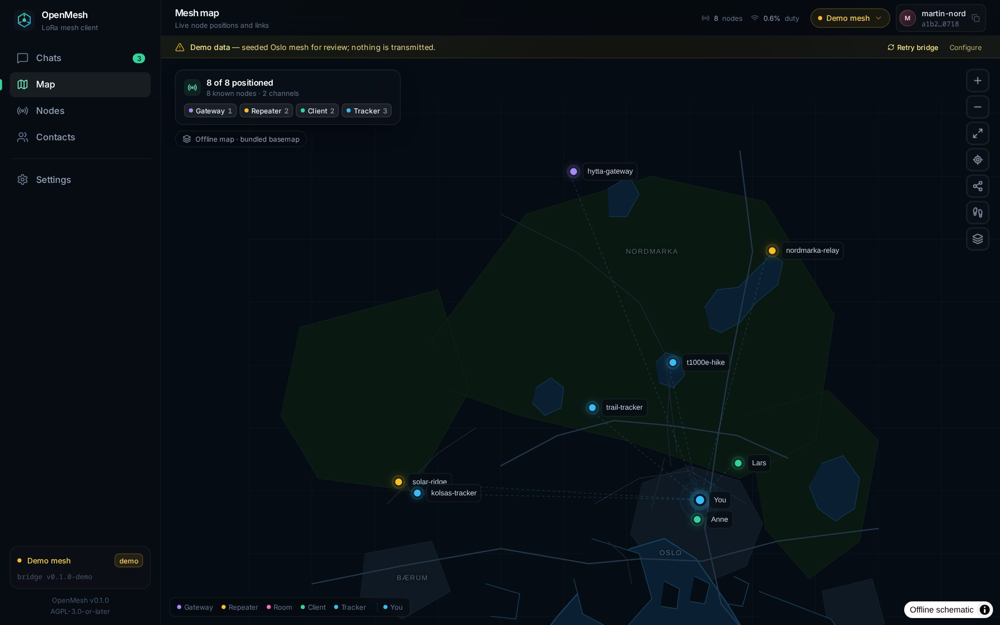
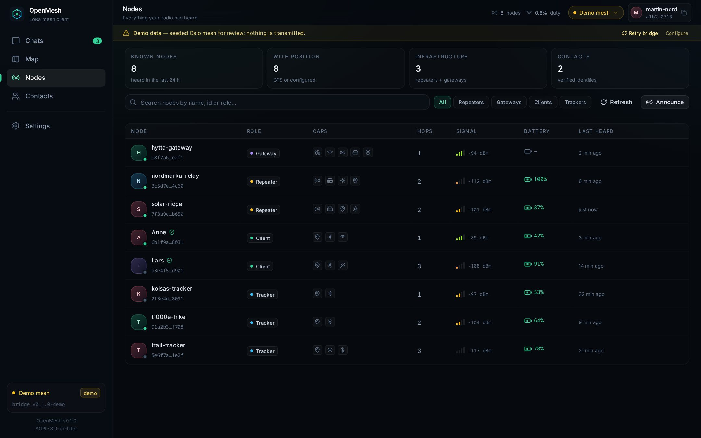
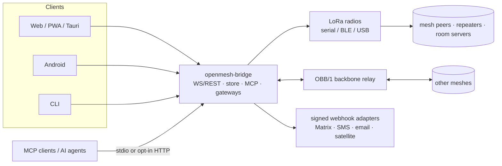

<div align="center">

# OpenMesh

**Private LoRa mesh for text, images, tiny voice and AI operators.**
No accounts. No cell towers. No cloud. Just radios, repeaters and your people.

[](https://github.com/martintondel02/openmesh/actions/workflows/ci.yml)
[](https://github.com/martintondel02/openmesh/releases)
[](LICENSE)
[](docs/architecture/PROTOCOL.md)
[](rust-toolchain.toml)
[](docs/ROADMAP.md)


> **Roadmap:** shipped through **v0.7.1** · next: **OpenWeb — pages over the mesh** (v0.8) →
> [visual roadmap & milestones](docs/ROADMAP.md)

**Docs:** [Quick start](docs/QUICKSTART.md) · [Install](docs/INSTALL.md) ·
[Architecture](docs/architecture/ARCHITECTURE.md) · [Protocol](docs/architecture/PROTOCOL.md) ·
[Hardware](docs/hardware/boards.md) · [AI agents (MCP)](docs/agents/mcp.md) ·
[Roadmap](docs/ROADMAP.md)

</div>

---

## What is OpenMesh?

OpenMesh is a from-scratch alternative to Meshtastic, built around two things the existing LoRa
mesh ecosystem does badly: **sending pictures and voice notes** over links that carry a few
hundred bytes per second, and **clients that people actually enjoy using**.

It is a complete stack: a new encrypted mesh protocol (**OMP/1**), firmware for real off-the-shelf
LoRa boards, repeater nodes that extend range and store messages for people who are offline, a
local bridge daemon, and web/desktop/Android clients with chat, group chats, a live map, location
sharing, media, and an AI-native control plane.

**What you get today (v0.7.1):**

- 🔐 **Encrypted text and group channels** over a 240-byte-frame LoRa protocol, with ACKs, retries,
  store-and-forward repeaters and golden-vector conformance between Rust and C++.
- 🖼️ **Media that fits the channel** — Tiny/Medium/High/Original image tiers and **Codec2 tiny
  voice** (8 s ≈ 1.4 KiB) alongside Opus, with measured size and airtime shown before sending.
- 📡 **Your own infrastructure** — authenticated `OBB/1` backbone relays, multiple backbone links
  per node, Openflare/WireGuard/Tailscale exposure guidance, and a live control panel.
- 📱 **Web, desktop and native Android** clients — PWA/Tauri, on-device Rust engine over UniFFI,
  BLE/USB radios, QR invites, offline help.
- 🧭 **Beginner-first UX with real depth** — guided secure setup, beginner/advanced modes, 18 help
  topics, legal-maximum region defaults and a warning-gated emergency override.
- 🤖 **AI-native operations** — 27-tool MCP server over stdio or opt-in HTTP, signed webhook
  gateways, an activity log attributing every write, and OpenAPI 3.1 for everything else.

### What it looks like

| Map | Nodes |
| --- | --- |
|  |  |

| Backbone control panel | Media tiers with measured airtime |
| --- | --- |
|  |  |

| Gateways (signed webhooks) | Android app |
| --- | --- |
|  |  |

Every screenshot is the real client in demo mode (`?demo=1`) — no mockups.
`pnpm --dir apps/web dev` then visit `http://localhost:5173/?demo=1`.

---

## Feature status (v0.7.1)

| Area | Status |
| --- | --- |
| **OMP/1 protocol** — wire, crypto, announces, managed flooding, dedup | ✅ implemented + byte-identical golden vectors |
| **Messaging** — direct + group encrypted messages, ACKs, retries | ✅ |
| **Media** — images (Tiny/Medium/High/Original), Codec2 1.3/3.2 kbps + Opus voice | ✅ measured airtime, cross-client |
| **Position + map** — location sharing, live node map, telemetry | ✅ |
| **Store-and-forward** — repeaters hold encrypted envelopes for offline peers | ✅ protocol + firmware |
| **Backbone** — authenticated TCP relay, live panel, installer, multiple links | ✅ OBB/1 + v0.7 links |
| **Remote operations** — opt-in MCP over HTTP (`/mcp`), HMAC webhook gateways | ✅ read-only MCP default, audited |
| **Beginner UX** — guided secure setup, beginner/advanced modes, 18 help topics | ✅ |
| **AI-native** — 27 MCP tools, activity log, OpenAPI 3.1, agent prompts | ✅ stdio + HTTP |
| **Android** — on-device Rust engine, BLE/USB, media, QR, notifications | ✅ APK in every release |
| **Desktop/PWA** — React + MapLibre web client, Tauri 2 shell | ✅ web; Tauri needs system WebView deps |
| **Firmware** — T1000-E, RAK4631 solar, SenseCAP Solar P1, Heltec Tracker | ✅ source + CI matrix, field QA pending |
| **Flashers** — browser (WebSerial/UF2) + Linux CLI | ✅ |
| **Next: OpenWeb pages** — mesh-native sites, cached bundles, mesh CDN | 🗺️ [v0.8 plan](docs/ROADMAP.md) |
| **Later: OMP/2, NomadNet bridge** — ratchets, directed routing, interop | 🗺️ [roadmap](docs/ROADMAP.md) |

**Verified at this tag:** 291 Rust tests · 288 web tests · 77 Android JVM tests · 51 firmware host
cases (3,639 assertions) · `check_docs`/`check_help`/`check_openapi` green · CI, Android, Firmware,
CodeQL and Release workflows green. No protocol/wire change since v0.5.

---

## Quick start

### Install a release

```bash
curl -fsSL https://github.com/martintondel02/openmesh/releases/latest/download/install.sh | sh
openmesh-bridge --version
```

Linux, macOS and Windows builds are attached to every release, together with the web bundle, the
Android APK and `SHA256SUMS.txt`. See the [install guide](docs/INSTALL.md) for systemd, ports and
upgrades.

### From source (5 minutes)

```bash
git clone https://github.com/martintondel02/openmesh.git
cd openmesh

# 1. Protocol tests + 5-node relay/loss/store-forward simulator
cargo test -p openmesh-core
cargo run -p openmesh-sim

# 2. Bridge + web client in demo mode (simulated radio, seeded network)
cargo run -p openmesh-bridge -- --demo          # API at http://127.0.0.1:8787
pnpm --dir apps/web install
pnpm --dir apps/web dev                          # http://localhost:5173

# 3. Or let the bridge serve the built UI on http://127.0.0.1:8787
pnpm --dir apps/web build
cargo run -p openmesh-bridge -- --demo --serve-web apps/web/dist

# 4. Pure web demo, no backend at all
pnpm --dir apps/web dev
#    deep links: /?demo=1&screen=map|nodes|contacts|settings|backbone|agents
```

Tiny Codec2 voice in a web dev build needs the WASM module: run
`./scripts/build-voice-wasm.sh` once (it downloads no toolchain beyond the Rust
`wasm32-unknown-unknown` target). Without it, the UI gracefully disables Tiny/Medium voice and keeps
Opus.

**Build environment note:** the repository is developed on a Fedora host without a system C
compiler; `scripts/dev-env.sh` wires `zig` in as `cc` for Rust builds. On a normal machine with
gcc/clang you can ignore it. Rust 1.85+, Node 22+ and pnpm are required; Android needs the SDK/NDK
(see [apps/android/README.md](apps/android/README.md)).

### Flash a radio

```bash
# Browser: open apps/flasher/index.html (ESP32-S3 via WebSerial, nRF52 via UF2 download)
# Linux/Fedora CLI:
tools/flash/openmesh-flash --list
tools/flash/openmesh-flash --board t1000e --uf2 build/t1000e.uf2
tools/flash/openmesh-flash --board heltec_tracker --port /dev/ttyACM0
```

Boards, pin maps, power budgets and build commands: [docs/hardware/boards.md](docs/hardware/boards.md).

---

## How the pieces fit



- **`openmesh-core`** is a deterministic, IO-free OMP/1 engine: one implementation drives the
  bridge, simulator, tests and (via UniFFI) the phone.
- **`openmesh-bridge`** is the local daemon: transports (sim, UDP LAN, TCP, serial), redb storage,
  WebSocket/REST API, attachments, MCP, help/setup APIs, backbone and gateways.
- **Transports are interchangeable.** The same OMP frames flow over LoRa radios, UDP/LAN,
  serial/BLE/USB companion links, and authenticated `OBB/1` backbone TCP — with dedup and TTLs
  making multi-path safe.
- **Relays are dumb and untrusted.** Repeaters and backbones forward/store ciphertext and routing
  metadata only; they never hold message keys.
- **Clients are the product.** The web/PWA, desktop shell and Android app share the same protocol,
  presets, help corpus and design language.

---

## Highlights

### Media that fits the airtime (v0.6)

Airtime is the product constraint. Every send shows the **actual bytes, estimated airtime and % of
the hourly duty budget**, and the app suggests the largest tier that fits the active radio profile.

| Tier | Images | Voice | 8 s voice |
| --- | --- | --- | --- |
| **Tiny** | 320 px WebP | **Codec2 1.3 kbps** | ≈ **1.4 KiB** (≈ 7 s airtime at `MEDIUM_FAST`) |
| **Medium** | 640 px WebP | **Codec2 3.2 kbps** | ≈ 3.2 KiB |
| **High** | 1280 px WebP | **Opus 12 kbps** (Android may use AAC/MP4) | ≈ 12 KiB |
| **Original** | untouched | — | confirmation-gated; disabled on `LONG_*` |

Codec2 is pure Rust (`codec2` crate, LGPL-2.1/MIT): the same code runs in the browser through a
small WASM module, in the Android engine via UniFFI, and in Rust tests/CLI — no C toolchain or NDK
codec build. Tiny voice makes voice practical even on `LONG_SLOW`. No protocol change: resources
already carry MIME + bytes.

[Media tiers contract](docs/design/media-tiers.md) · [help: images and voice notes](content/help/media.md) ·
[PROTOCOL §9.4](docs/architecture/PROTOCOL.md)

### Legal radio defaults, honest overrides (v0.5)

Defaults are the **legal maxima** for the selected region (EU868 27 dBm EIRP / 10 % duty / 250 kHz,
with EU433, US915, AU915, IN865, KR920 and AS923 supported). Profiles wider than a region's legal
bandwidth are rejected with a visible fallback.

For genuine emergencies there is an advanced, off-by-default **regulatory override** for duty cycle,
TX power and frequency: full warning, typed confirmation, persistent banner, activity-log entry and
one tap to disable. Hardware PA caps still apply. Lowering power/duty never needs it.

> **Not legal advice.** Region values are ceilings; antenna gain counts and rules vary by country.
> Verify with your regulator (Nkom in Norway) before deploying. See
> [regulatory and emergency guide](docs/guides/regulatory-and-emergency.md) and
> [ADR 0011](docs/adr/0011-regulatory-override.md).

### Backbones: one relay, many meshes (v0.2 → v0.7)

A bridge can run an always-on **`OBB/1` backbone**: an authenticated TCP relay with a live control
panel that stitches distant meshes together. A node can also join **several backbones at once** for
redundancy or separate communities; `(src, seq)` dedup keeps loops safe and each link has its own
status/backoff.

```bash
openmesh-bridge backbone --data-dir ~/.openmesh   # first run prints token, firewall and systemd steps
openmesh-bridge join 'openmesh://backbone?host=mesh.example.org&port=9443&token=…&node=…'
openmesh-bridge install-service --backbone         # keep it running across reboots
```

OMP frames stay **end-to-end encrypted**; the backbone relays ciphertext and routing metadata only.
Transport access uses a shared secret, and exposure guidance covers **Openflare** (outbound-only
tunnel), WireGuard/Tailscale and Caddy TLS. See [exposing your backbone](docs/guides/backbone-exposure.md),
[deployment and operations](docs/operations/backbone-deployment.md) and
[BACKBONE.md](docs/architecture/BACKBONE.md).

### Android in your pocket (v0.4)

A **standalone client**: the Rust engine runs on the phone, the radio is a connected pipe over BLE or
USB, and a foreground service keeps the mesh alive. Same onboarding, modes, help corpus, media
pipeline and secure presets as the web client.

```bash
# use the latest APK from Releases (debug builds in CI; signed release APKs when keystore is configured)
adb install openmesh-v0.7.1-android-debug.apk
# open the app → onboarding → pair your radio (BLE or USB) → send a message
```

Sideload only for now (no Play Store/F-Droid listing yet). Build/signing notes:
[apps/android/README.md](apps/android/README.md).

### Remote operations and AI agents (v0.3 → v0.7)

The bridge is designed to be operated by humans **and** agents, safely:

- **MCP server** with 27 typed tools (`openmesh-bridge mcp` over stdio; opt-in HTTP at `/mcp` with
  bearer auth, **read-only scope by default**, sessions/SSE, rate limits and audited writes).
- **Signed webhook gateways** in both directions: outbound HMAC-SHA256 `POST`s with channel filters,
  retries and delivery status; inbound `POST /api/gateways/{id}/inbound` injects a text message into
  a configured channel. Secrets are env-var names only — never stored, logged or returned. Adapter
  recipes for Matrix, SMS providers, email forwarders and satellite messengers.
- **Activity log** attributes every write to `user`, `web`, `cli`, `agent:<name>` or
  `gateway:<id>`; **OpenAPI 3.1** documents every REST route and is checked in CI.
- **Beginner and advanced modes** with a shared 18-topic **help corpus** powering the Help Center,
  `openmesh_help` and the docs.

```bash
openmesh-bridge mcp                                  # stdio MCP server
openmesh-cli agent config --client claude            # paste-ready client config
openmesh-cli agent config --transport http --url http://127.0.0.1:8787/mcp
openmesh-cli agent prompt --tier beginner            # live-state system prompt
openmesh-cli agent activity --limit 20               # what did the agent do?
```

[Remote operations guide](docs/guides/remote-operations.md) ·
[help: gateways and remote agents](content/help/gateways-and-remote-agents.md) ·
[MCP reference](docs/agents/mcp.md) · [ADR 0012](docs/adr/0012-remote-mcp-and-gateways.md)

---

## Hardware

| Board | Radio | GPS | Best role |
| --- | --- | --- | --- |
| Seeed SenseCAP T1000-E | LR1110 | ✅ | pocket tracker / client |
| RAK WisBlock solar node (RAK4631) | SX1262 | — | solar repeater |
| Seeed SenseCAP Solar Node P1 | SX1262 | ✅ | solar repeater / gateway |
| Heltec Wireless Tracker | SX1262 | ✅ | tracker / screen node / WiFi gateway |

Pin maps, power budgets, flash instructions and board caveats:
[docs/hardware/boards.md](docs/hardware/boards.md). Hardware field validation is the gate for
calling a release "recommended for real use" — see the [roadmap](docs/ROADMAP.md).

---

## Documentation

| Start here | Deep dives |
| --- | --- |
| [Quick start (10 min)](docs/QUICKSTART.md) · [Install](docs/INSTALL.md) | [Architecture](docs/architecture/ARCHITECTURE.md) · [OMP/1 protocol](docs/architecture/PROTOCOL.md) |
| [Help corpus](content/help/) · [FAQ](docs/guides/faq.md) · [Troubleshooting](docs/guides/troubleshooting.md) · [Glossary](docs/glossary.md) | [WebSocket + REST API](docs/architecture/WEBSOCKET-API.md) · [OpenAPI 3.1](docs/api/openapi.json) |
| [Hardware and flashing](docs/hardware/boards.md) | [Backbone (OBB/1)](docs/architecture/BACKBONE.md) · [deployment & sizing](docs/operations/backbone-deployment.md) |
| [AI agents (MCP)](docs/agents/mcp.md) · [agent prompts](docs/agents/prompts.md) | [Media tiers](docs/design/media-tiers.md) · [remote operations](docs/design/remote-operations.md) · [regulatory design](docs/design/regulatory-and-regions.md) |
| [AGENTS.md](AGENTS.md) · [llms.txt](llms.txt) | [ADRs](docs/adr/) · [research](docs/research/) · [roadmap](docs/ROADMAP.md) · [changelog](CHANGELOG.md) |

---

## Security and privacy

OpenMesh is **alpha software and has not been audited**. The protocol provides end-to-end
encryption for messages and attachments and signature authentication for group messages, but
v1 has **no forward secrecy and no traffic-analysis resistance**. Do not use it as your only
lifeline.

- Relays and backbones see **ciphertext and routing metadata**, never message keys. Message bodies,
  tokens, PSKs and identity seeds are never logged.
- **Webhook gateways break end-to-end encryption for the bridged leg** — the adapter/operator sees
  plaintext there. Remote MCP is loopback/tunnel-only, read-only by default, and every write is
  audited.
- Radio defaults are legal maxima, not permission: **verify your local rules** (no blanket "wartime"
  waiver exists), and hardware PA caps remain absolute.
- Threat model: [ARCHITECTURE.md §Security](docs/architecture/ARCHITECTURE.md#6-security-model) ·
  reporting vulnerabilities: [SECURITY.md](SECURITY.md).

## How this project is built

OpenMesh is **AI-assisted and human-directed**. AI tools help draft protocol code, firmware,
clients, tests and documentation; humans define the contracts, review every change, run the test and
QA gates (including real-device Android testing and firmware host-vector conformance), and own the
releases. AI output is treated as untrusted until reviewed and tested — no part of this project is
claimed to be "fully AI-generated". Process and honest limits:
[AI development workflow](docs/research/ai-development-workflow.md); rules:
[AI-POLICY.md](AI-POLICY.md).

**Contributions are closed for now.** OpenMesh is developed only by the repository owner and their
designated AI assistant; external PRs are auto-closed and issues/discussions are disabled until
contributions open. When they do, [CONTRIBUTING.md](CONTRIBUTING.md) and the strict AI policy apply:
human authors are accountable, AI involvement must be disclosed, and every change must pass the full
gate set.

---

## Repository layout

```text
crates/openmesh-core       OMP/1 engine: wire, crypto, resources, store-forward
crates/openmesh-bridge     Local daemon: transports, redb store, WS/REST, MCP, gateways, backbone
crates/openmesh-cli        Terminal client, diagnostics, agent helpers
crates/openmesh-sim        Deterministic mesh simulator (scenarios, loss/latency models)
crates/openmesh-ffi        UniFFI surface for native mobile clients
crates/openmesh-voice      Codec2 tiny/medium voice (pure Rust)
crates/openmesh-voice-wasm WASM wrapper for browser Codec2 encode/decode
firmware/                  PlatformIO C++17 firmware for four reference boards
apps/web                   React 19 + MapLibre client (PWA + Tauri 2 desktop shell)
apps/flasher               Browser flasher (esp-web-tools + UF2)
apps/android               Native Android app (Compose, BLE/USB companion)
tools/flash                Linux/Fedora flasher CLI
protocol/vectors           Golden vectors shared by Rust and firmware
content/help               Help corpus (web, Android, API, MCP — one source)
content/presets            Shared setup/media presets
docs/                      Architecture, protocol, ADRs, design contracts, research, hardware
```

## Acknowledgements

OpenMesh stands on the shoulders of [Reticulum](https://reticulum.network/) by Mark Qvist,
[Ratspeak](https://ratspeak.org/), [Meshtastic](https://meshtastic.org/),
[MeshCore](https://meshcore.io/), and the LoRa/Semtech community. No code from restricted
licences (including LXST/rsLXST) is used. Third-party notices: [NOTICE](NOTICE).

## Licence

[AGPL-3.0-or-later](LICENSE). If you run a modified OpenMesh node or service over a network, you
must publish your changes — the mesh stays open.
