<div align="center">

# OpenMesh

**Encrypted mesh messaging over LoRa — text, images and voice notes.**
No accounts. No cell towers. No cloud. Just radios, repeaters and your people.

[](https://github.com/martintondel02/openmesh/actions/workflows/ci.yml)
[](LICENSE)
[](docs/architecture/PROTOCOL.md)
[](docs/ROADMAP.md)
[](rust-toolchain.toml)

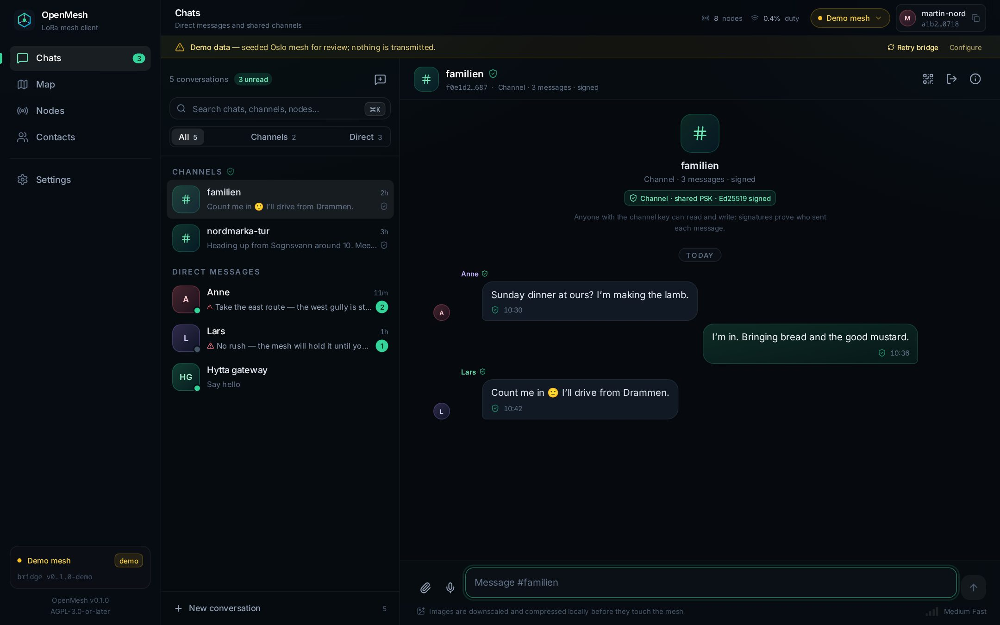

**Docs:** [Quick start](docs/QUICKSTART.md) ·
[Architecture](docs/architecture/ARCHITECTURE.md) ·
[Protocol spec](docs/architecture/PROTOCOL.md) ·
[Agent (MCP)](docs/agents/mcp.md) ·
[Hardware](docs/hardware/boards.md) ·
[Roadmap](docs/ROADMAP.md)

</div>

---

## What is OpenMesh?

OpenMesh is a from-scratch alternative to Meshtastic, built around two things the existing LoRa
mesh ecosystem does badly: **sending pictures and voice notes** over links that carry a few
hundred bytes per second, and **clients that people actually enjoy using**.

It is a complete stack: a new encrypted mesh protocol (**OMP/1**), firmware for real off-the-shelf
LoRa boards, repeater nodes that extend range and store messages for people who are offline, a
local bridge daemon, and web/desktop/Android clients with chat, group chats, a live map, location
sharing and node telemetry.

```
       phones · laptops · tablets
              │  WebSocket / USB / BLE
      ┌───────▼────────┐
      │ openmesh-bridge│  local daemon: storage, media, transports
      │  openmesh-core  │  OMP/1 protocol engine (deterministic, IO-free)
      └───┬────────┬───┘
          │ USB    │ WiFi / Ethernet (UDP, TCP)
   ┌──────▼──┐  ┌──▼────────┐
   │  radio  │  │  gateway  │
   └──┬──────┘  └──┬────────┘
      │    LoRa 868/915 MHz
   ┌──▼─────────────────────────────┐
   │  trackers · repeaters · room   │
   │  servers · other people        │
   └────────────────────────────────┘
```

### The client

| Map | Nodes |
| --- | --- |
|  |  |

| Contacts | Settings | Mobile |
| --- | --- | --- |
| 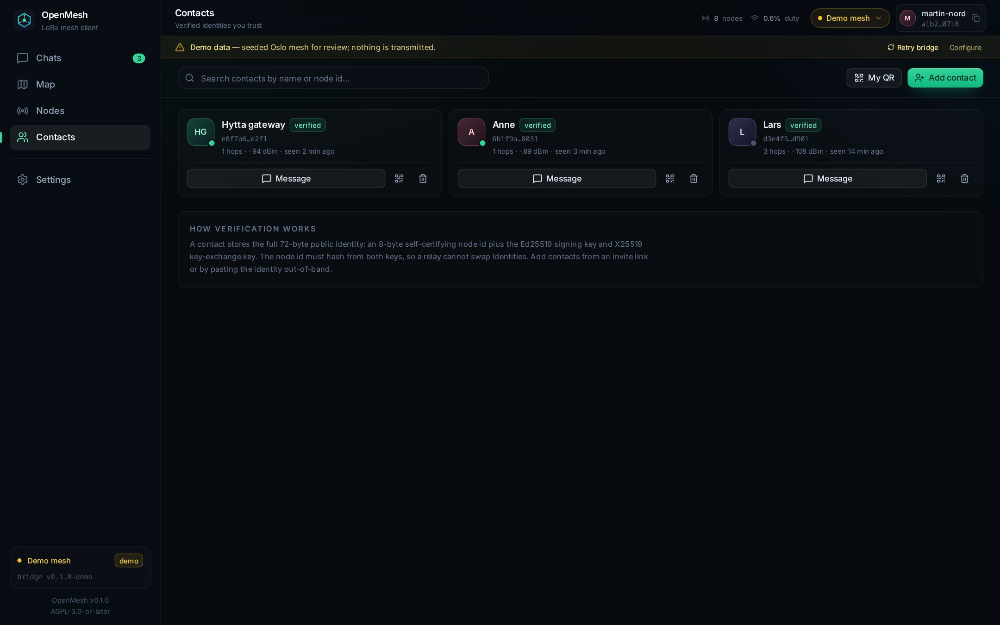 | 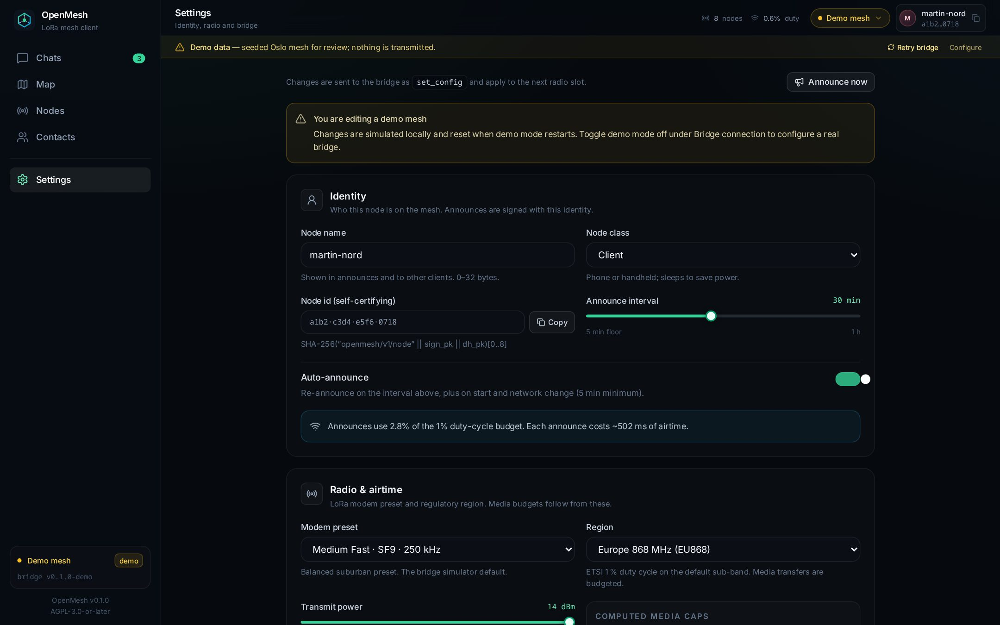 | 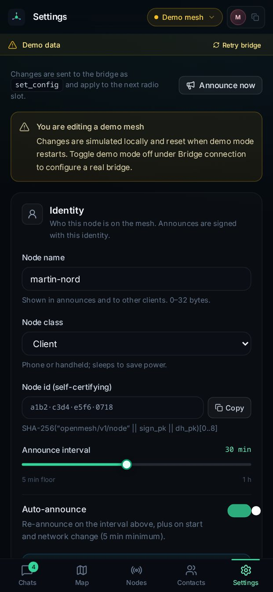 |

Every screenshot is the real client in demo mode (`?demo=1`), no mockups:
`pnpm --dir apps/web dev` then visit `http://localhost:5173/?demo=1`.

## Why another mesh protocol?

| | Meshtastic | MeshCore | Reticulum / Ratspeak | **OpenMesh** |
| --- | --- | --- | --- | --- |
| Text over LoRa | ✅ | ✅ | ✅ | ✅ |
| **Images** | thumbnails, clunky | limited | ✅ but slow/heavy | ✅ compressed, airtime-honest |
| **Voice notes** | ❌ | ❌ | ✅ (LXST, restricted licence) | ✅ Opus/Codec2, chunked |
| Repeaters that **store messages** | limited | room servers | propagation nodes | ✅ envelope store-and-forward |
| Client quality | functional | niche | Ratspeak is good, ecosystem isn't | ✅ first-class web/desktop/mobile |
| Multi-transport (LoRa + LAN + BLE) | partial | partial | ✅ excellent | ✅ same frames everywhere |
| Firmware footprint | large | small | large (Python) / niche Rust | small C++17 core |
| Licence | GPL-3.0 | MIT-ish | Reticulum Licence | **AGPL-3.0** |

We borrow the good ideas (managed flooding, announce-based discovery, store-and-forward
envelopes) and reject what makes life hard on a 240-byte MTU: global routing state, handshake
per message, and client stacks nobody wants to use. Details and trade-offs:
[ADR-0001](docs/adr/0001-own-protocol-vs-reticulum.md), [research notes](docs/research/).

## Feature status (v0.7.1)

| Area | Status |
| --- | --- |
| OMP/1 wire protocol, crypto, announces, flooding, dedup | ✅ implemented + golden vectors |
| Direct & group encrypted messaging | ✅ |
| Images (compressed, chunked) + voice notes | ✅ tiers: Tiny/Medium/High/Original images; Codec2 tiny/medium + Opus high voice |
| Position sharing + map | ✅ |
| Repeater store-and-forward | ✅ protocol + firmware |
| Bridge daemon (WS/REST, redb persistence, attachments) | ✅ |
| **Backbone mode** (authenticated TCP relay + live control panel + installer) | ✅ v0.2 |
| **Beginner UX** (guided secure setup, beginner/advanced modes, Help Center, glossary) | ✅ v0.3 |
| **AI-native** (MCP server, 27 agent tools, activity log, OpenAPI 3.1, prompt pack) | ✅ v0.3 |
| **Android app** (on-device Rust engine via UniFFI, BLE/USB, images, voice, QR, notifications) | ✅ v0.4 |
| **Public exposure guidance** (Openflare tunnel, WireGuard/Tailscale/TLS alternatives) | ✅ v0.4 |
| **Legal-maximum region defaults** (EU/Norway audited, EU433, bandwidth validation) | ✅ v0.5 |
| **Regulatory override** (duty/power/frequency, warning + typed confirmation + audit) | ✅ v0.5 |
| Web / PWA client (chat, groups, map, voice, images, demo mode) | ✅ |
| Desktop packaging (Tauri 2, Linux/macOS/Windows) | ✅ config; build needs system webkit2gtk/WebView deps |
| Firmware: 4 reference boards + golden-vector conformance | ✅ code complete, build matrix in CI |
| Web + CLI flashers | ✅ |
| OMP/2: forward secrecy, voice calls, directed routing | 🗺️ [roadmap](docs/ROADMAP.md) |
| NomadNet / Reticulum gateway | 🗺️ [design](docs/research/nomadnet-bridge.md) |

## Hardware

| Board | Radio | GPS | Best role |
| --- | --- | --- | --- |
| Seeed SenseCAP T1000-E | LR1110 | ✅ | pocket tracker / client |
| RAK WisBlock solar node (RAK4631) | SX1262 | — | solar repeater |
| Seeed SenseCAP Solar Node P1 | SX1262 | ✅ | solar repeater / gateway |
| Heltec Wireless Tracker | SX1262 | ✅ | tracker / screen node / WiFi gateway |

Pin maps, power budgets and flashing instructions: [docs/hardware/boards.md](docs/hardware/boards.md).

## Quick start

```bash
# 0. Or install a prebuilt release (Linux/macOS; Windows tarball in Releases)
curl -fsSL https://github.com/martintondel02/openmesh/releases/latest/download/install.sh | sh
openmesh-bridge --version

git clone https://github.com/martintondel02/openmesh.git
cd openmesh

# 1. Protocol tests
cargo test -p openmesh-core

# 2. Mesh simulator — watch a 5-node relay chain, lossy links, store-and-forward
cargo run -p openmesh-sim

# 3. Bridge daemon in demo mode (simulated radio + seeded network)
cargo run -p openmesh-bridge -- --demo
#    then open the web client:
pnpm --dir apps/web install
pnpm --dir apps/web dev            # http://localhost:5173
#    or let the bridge serve the built UI on http://127.0.0.1:8787

# 4. Web client in pure demo mode (no backend at all)
pnpm --dir apps/web dev           # works standalone with seeded data
#    deep links: /?demo=1&screen=map|nodes|contacts|settings  ·  &thread=familien|anne|lars
```

What is green today: **96 protocol-core tests**, **66 bridge/sim/CLI tests** (including a real
WebSocket → mesh → ACK round-trip), **119 web-client tests**, and **44 firmware host test cases
(3 421 assertions) replaying the cross-language golden vectors** byte-for-byte.

Build environment note: this repository is developed on a Fedora box without a system C
compiler; `scripts/dev-env.sh` wires `zig` in as `cc` for Rust builds. On a normal machine with
gcc/clang installed you can ignore it.

### Flashing a radio

```bash
# Browser: open apps/flasher/index.html (ESP32-S3 via WebSerial, nRF52 via UF2 download)
# Linux/Fedora CLI:
tools/flash/openmesh-flash --list
tools/flash/openmesh-flash --board t1000e --uf2 build/t1000e.uf2
tools/flash/openmesh-flash --board heltec_tracker --port /dev/ttyACM0
```

## Android, beginner-friendly, and AI-native (v0.3–v0.4)

Mesh software is usually built for people who already understand radios, keys and airtime. OpenMesh
v0.3 shipped **two front doors and one source of truth**; **v0.4 adds the phone** — the same engine
and the same secure defaults, running natively on Android:

- **A 3-minute secure setup.** A guided wizard asks three questions (what is this box, where are
  you, keep my location private?) and applies a **secure preset**: region from your country,
  sensible radio profile, private channel with a generated key, invite QR, position sharing off,
  token auth on. A resumable "Get started" checklist follows you until the node is set up.
- **Beginner / Advanced modes.** Beginner shows only the choices that matter, explained in plain
  language with a `?` on every control. Advanced reveals everything — airtime math, TTLs, raw
  identities, allowlists, token rotation — with the exact numbers and no hidden settings.
- **One help corpus, everywhere.** The same 17 help topics + glossary power the in-app **Help
  Center** (search, beginner/advanced filter, deep links from every tooltip), the bridge
  `GET /api/help` API, and the AI agent's `openmesh_help` tool. Docs, UI and agents cannot disagree.
- **A phone that works offline.** The Android app runs the Rust engine on-device over BLE/USB,
  keeps the mesh alive in a foreground service, and ships the same onboarding, modes and Help Center
  (plus QR invites, images, voice notes and notifications).
- **An AI-native control plane.** `openmesh-bridge mcp` exposes **27 tools** over the Model Context
  Protocol — status, nodes, messages, channels, contacts, config, backbone, setup, help, activity —
  so Claude Code, Cursor, DSH or any MCP client can manage a node with typed tools, read-only mode,
  `confirm: true` on destructive actions, and an **activity log** attributing every write to
  `user`, `web`, `cli` or `agent:<name>`.
- **Copy-paste agent prompts.** `openmesh-cli agent prompt --tier beginner|advanced` prints a ready
  system prompt with live mesh state; `docs/agents/prompts.md` has seven scenarios (troubleshoot,
  family setup, VPS backbone, developer integration…), and [`AGENTS.md`](AGENTS.md) +
  [`llms.txt`](llms.txt) tell coding agents how to work on the project itself.
- **Machine-readable everything.** Complete [OpenAPI 3.1](docs/api/openapi.json) for the REST API,
  checked in CI against the actual router.

```bash
openmesh-bridge mcp                              # MCP server on stdio (Claude Desktop/Code, Cursor, DSH)
openmesh-cli agent config --client claude       # copy-paste client config
openmesh-cli agent prompt --tier beginner       # ready system prompt, live state included
openmesh-cli agent activity                     # what did my agent actually do?
```

| Guided secure setup | Help Center |
| --- | --- |
| 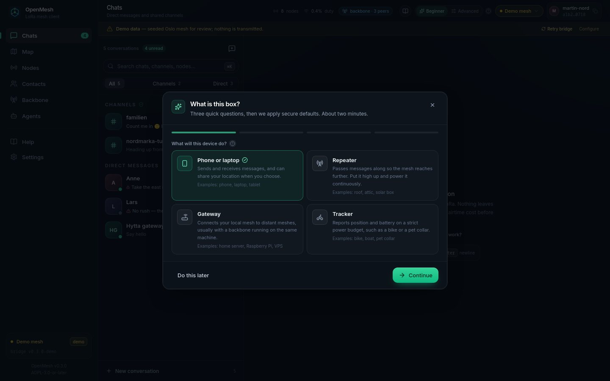 | 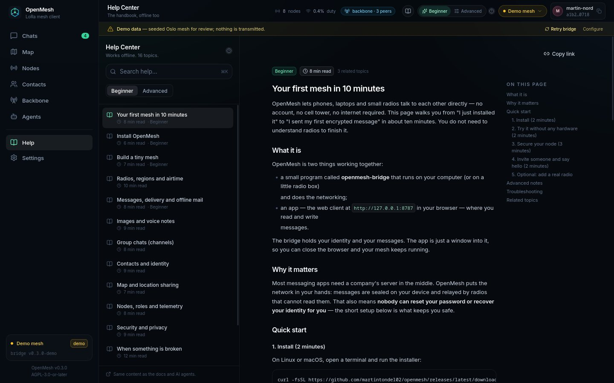 |

| Agents — MCP config, prompts and attributed activity | Beginner settings — secure defaults explained |
| --- | --- |
| 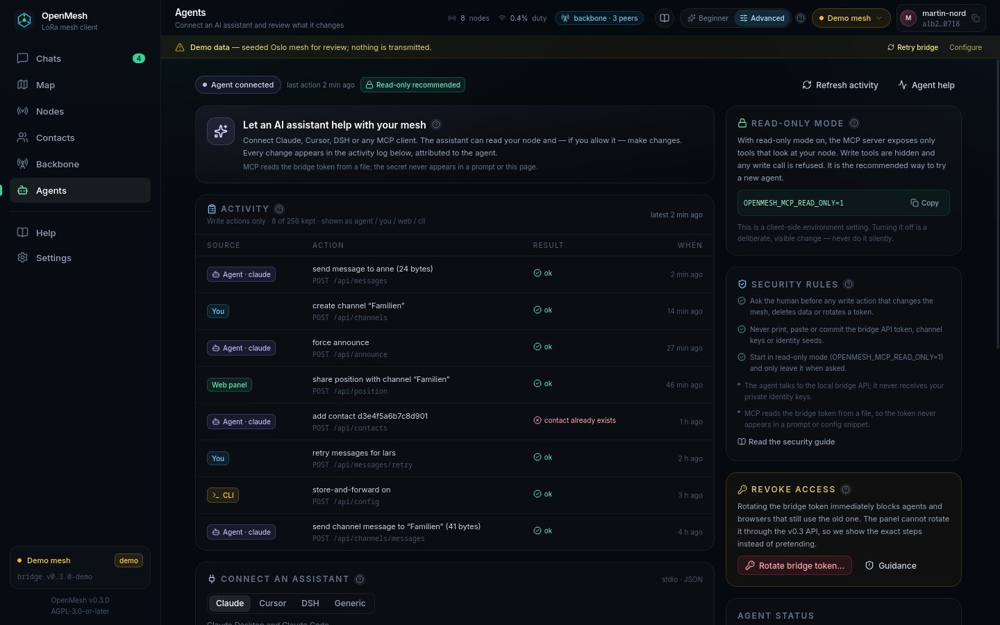 | 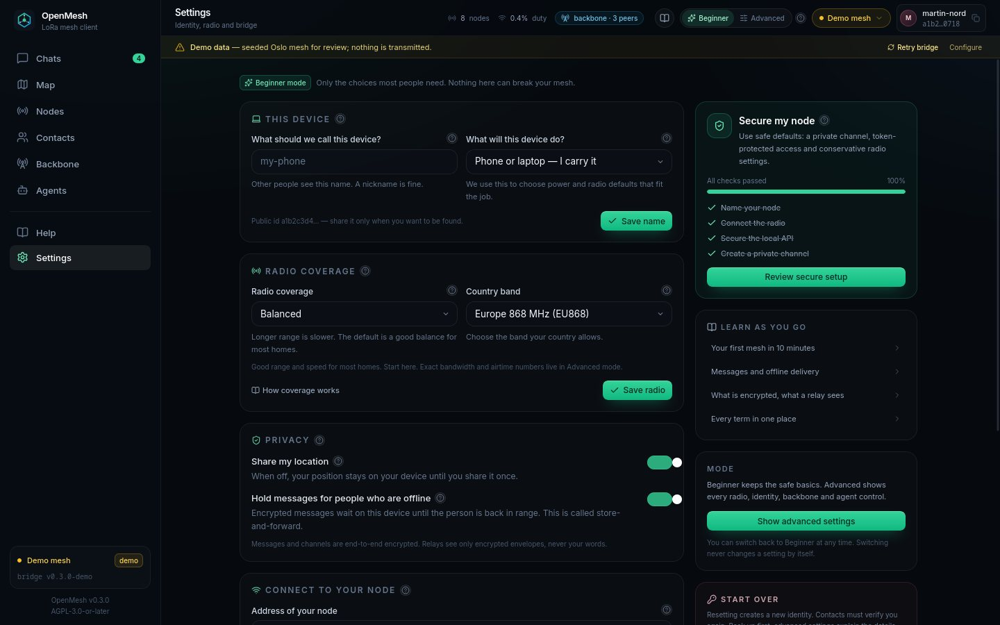 |

Read: [Quick start (10 minutes)](docs/QUICKSTART.md) ·
[Help topics](content/help/) ·
[MCP + prompts](docs/agents/mcp.md) ·
[API](docs/api/openapi.json) · [ADR 0010](docs/adr/0010-ai-native-and-beginner-ux.md)

## Run a backbone (v0.2)

A bridge can act as an always-on **backbone**: an authenticated TCP relay with a live control
panel that stitches distant meshes into one network — no central service, no account, no cloud.
Perfect for a VPS, Raspberry Pi or a box on a shelf.

```bash
curl -fsSL https://github.com/martintondel02/openmesh/releases/latest/download/install.sh | sh
openmesh-bridge backbone --data-dir ~/.openmesh
```

First run generates a 32-byte token, persists `~/.openmesh/backbone.json` (mode 0600) and prints a
step-by-step onboarding guide: your listen address, connection string, `firewalld`/`ufw` commands
and a ready-to-install systemd unit. The panel lives at **http://127.0.0.1:8787/backbone**:

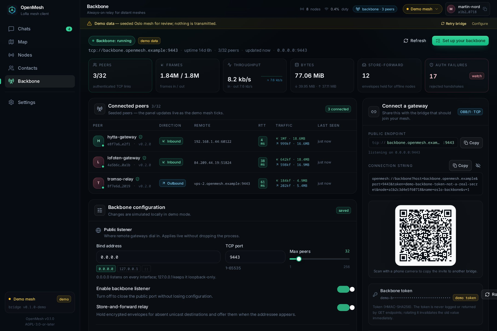

*The built-in setup wizard turns a fresh box into a backbone in six copy-paste steps:*


- **Live statistics** — peers, frames/bytes in and out, throughput, RTT, store-and-forward queue,
  auth failures, uptime.
- **Peer management** — who is connected, from where, how much they relay, one-click kick.
- **Controls** — enable/disable the listener, bind address and port, max peers, token vs open
  (with a big red warning), allowlist, store-and-forward relay, token rotation (shown once).
- **Setup wizard** — install → firewall → systemd → share the `openmesh://backbone?…` link or QR →
  connect a gateway, all with copy buttons.

Remote gateways and repeaters join with one command; they appear in the peer table and relay
traffic both ways:

```bash
openmesh-bridge join 'openmesh://backbone?host=mesh.example.org&port=9443&token=…&node=…'
openmesh-bridge install-service --backbone      # keep it running across reboots
```

OMP frames stay **end-to-end encrypted**: the backbone relays ciphertext and routing metadata
only. Transport access is protected by a shared secret. If your backbone is behind NAT or you'd
rather not open a port, use the built-in exposure guidance: **Openflare** (outbound-only tunnel,
[repo](https://github.com/martintondel02/openflare) — public launch in progress) or the
WireGuard/Tailscale/Caddy alternatives. Guides:
[exposing your backbone](docs/guides/backbone-exposure.md) · [install](docs/INSTALL.md) ·
[deployment, sizing, TLS, monitoring](docs/operations/backbone-deployment.md) ·
[protocol + security model](docs/architecture/BACKBONE.md) ·
[why these choices (ADR 0009)](docs/adr/0009-backbone-mode.md).

## Android app (v0.4)

The Android app is a **standalone client**: the Rust protocol engine runs on the phone (UniFFI),
the radio is a connected pipe over BLE or USB, and a foreground service keeps the mesh alive in
your pocket. No bridge, no server, no account.

```bash
# from the releases page: openmesh-v0.4.0-android-debug.apk (or a signed release APK)
adb install openmesh-v0.4.0-android-debug.apk
# then: open the app -> onboarding -> pair your radio (BLE or USB) -> send a message
```

- On-device engine: direct + channel messaging, images, voice notes, positions, retry/acks, and
  encrypted store-and-forward through radios — same OMP/1 protocol as the desktop bridge.
- Identity seed generated on the phone, Keystore-wrapped; contacts and channels survive restarts.
- Beginner onboarding applies the same secure preset as the web client (shared
  `content/presets/setup.json`), with a beginner/advanced mode switch, bundled Help Center and QR
  invites.
- Sideload only for now (no Play Store/F-Droid listing yet); debug APKs are built in CI, signed
  release APKs when keystore secrets are configured. Build/signing notes:
  [`apps/android/README.md`](apps/android/README.md).

| Onboarding (real device) | Chats & channels | Help (offline) |
| --- | --- | --- |
| 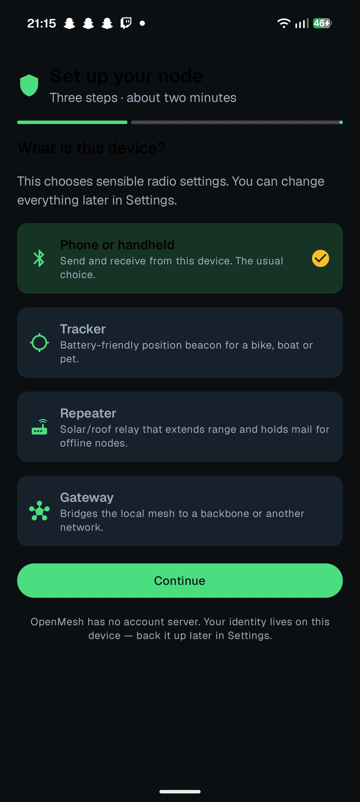 | 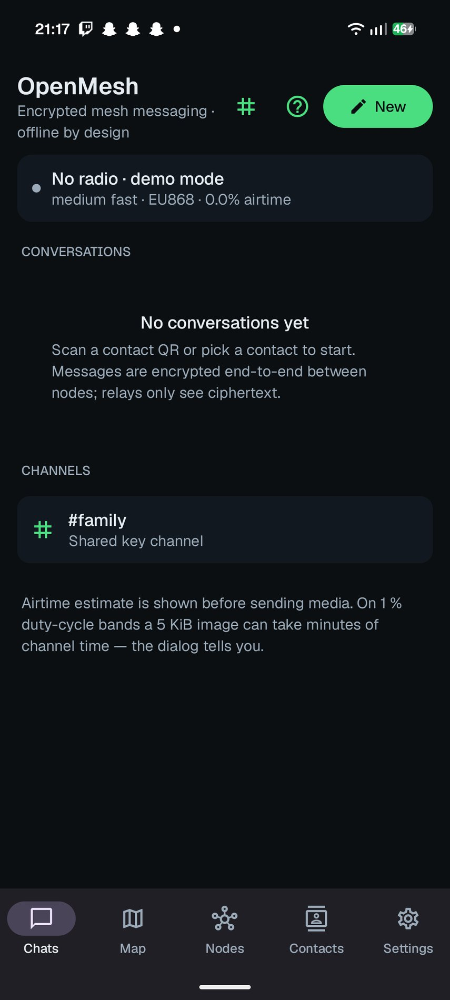 | 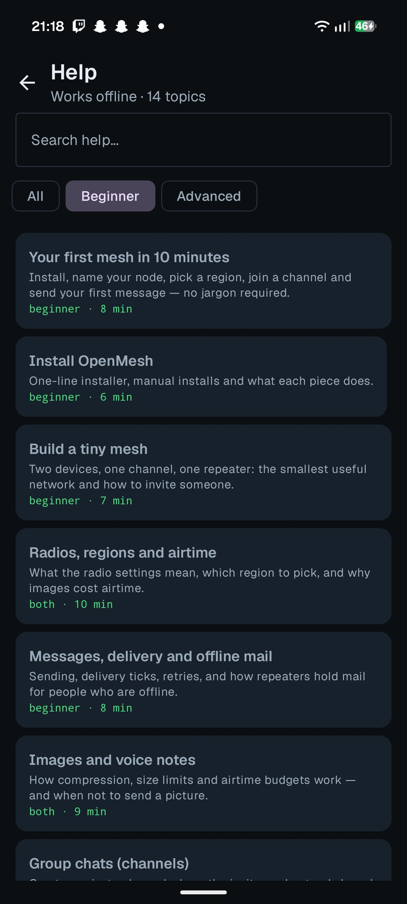 |

| Radio link | Settings (advanced) | Invite QR |
| --- | --- | --- |
| 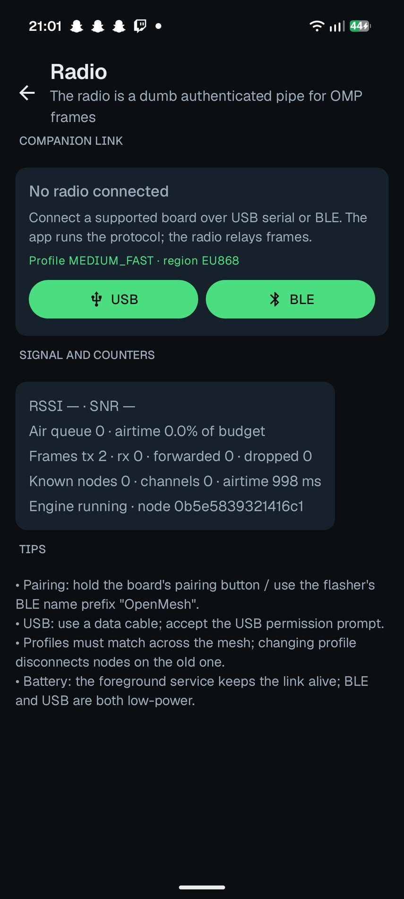 | 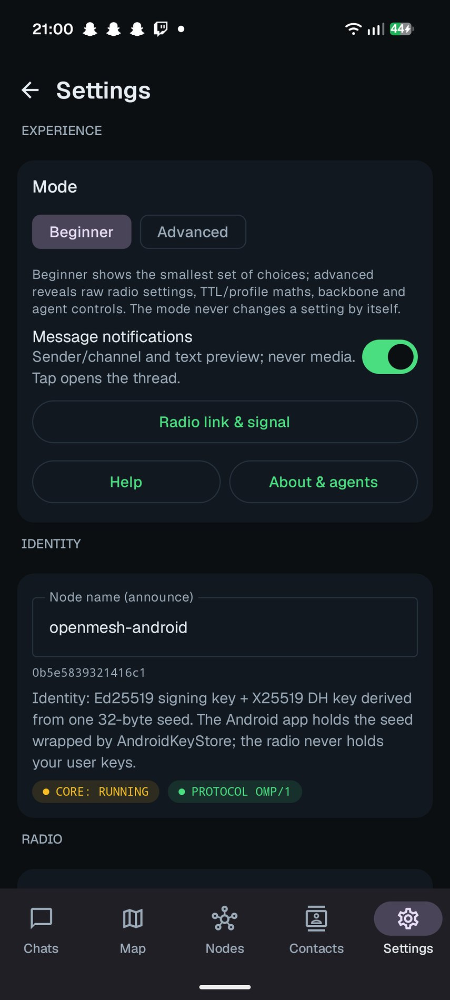 | 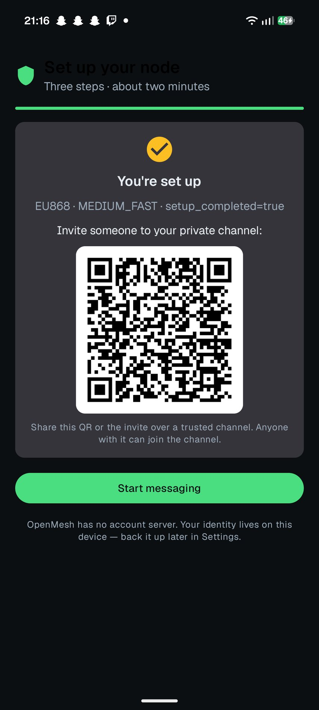 |

## Legal limits and emergency override (v0.5)

Radio is regulated, and defaults matter. Since v0.5 OpenMesh ships **legal-maximum region
defaults** instead of conservative ones: for most of Europe and Norway, `EU868` now defaults to
**27 dBm EIRP / 10 % duty cycle** in the 869.4–869.65 MHz sub-band (the old 14 dBm / 1 % values
were a hybrid of the 868.0–868.6 MHz rules — about 10× less airtime and 13 dB less link budget
than the law permits). A new `EU433` region is available, and profiles wider than a region's
legal bandwidth (e.g. 500 kHz `SHORT_TURBO` in `EU868`) are rejected.

For genuine emergencies there is a **regulatory override** — advanced mode only, off by default,
for duty cycle, TX power and frequency. It shows a full warning, requires an "I understand"
checkbox and typing `OVERRIDE`, keeps a persistent red banner and an activity-log entry, and is
one tap to disable. Hardware PA caps still apply (22 dBm SX1262, 15 dBm LR1110), so it cannot damage
the radio. Lowering power/duty never needs the override.

> **Not legal advice.** Region values are EIRP ceilings (antenna gain counts) and rules differ by
> country. Verify with your regulator (Nkom in Norway) before deploying. "Wartime" is not a legal
> permission software can grant; no blanket emergency waiver exists.

| Regulatory override modal (advanced) | Legal maxima in advanced settings |
| --- | --- |
| 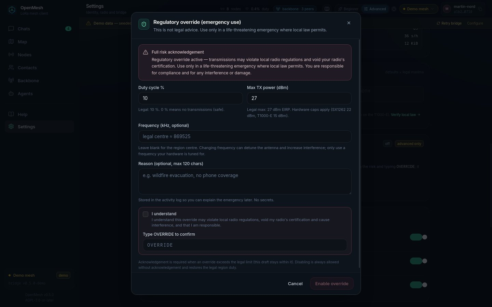 | 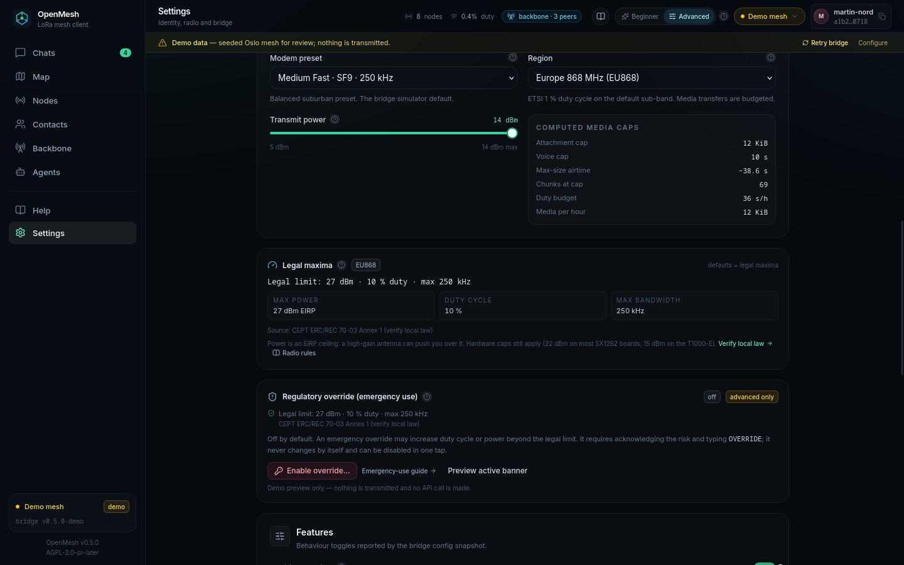 |

Guides: [legal limits and emergency override](docs/guides/regulatory-and-emergency.md) ·
[help topic](content/help/regulatory-and-emergency.md) ·
[ADR 0011](docs/adr/0011-regulatory-override.md) ·
[implementation contract](docs/design/regulatory-and-regions.md)

## Media tiers and tiny voice (v0.6)

Media is now **airtime-first**, with one shared tier table (`content/presets/media.json`) across
web, Android and tests. Every send shows the *actual* size, estimated airtime and % of the hourly
duty budget before it goes on air, and the app suggests the largest tier that fits the current
radio profile.

| Tier | Images | Voice | 8 s voice |
| --- | --- | --- | --- |
| **Tiny** | 320 px WebP | **Codec2 1.3 kbps** | ≈ **1.4 KiB** (≈ 7 s airtime at `MEDIUM_FAST`) |
| **Medium** | 640 px WebP | **Codec2 3.2 kbps** | ≈ 3.2 KiB |
| **High** | 1280 px WebP | **Opus 12 kbps** (Android may use AAC/MP4) | ≈ 12 KiB |
| **Original** | untouched | — | backbone/USB or explicit confirmation only |

Codec2 is pure Rust (`codec2` crate, LGPL-2.1/MIT): the same code runs in the browser through a
small WASM module, in the Android engine via UniFFI, and in the Rust CLI/tests — no C toolchain or
NDK codec build. Tiny voice is what makes voice practical on slow profiles: an 8-second note
costs less than one 640 px image, and even fits `LONG_SLOW` within a few seconds of airtime.
No protocol change: resources already carry MIME + bytes; vectors are untouched. Details:
[media tiers contract](docs/design/media-tiers.md) ·
[help: images and voice notes](content/help/media.md).

| Image tiers with measured cost | Voice tiers: Codec2 tiny/medium + Opus high |
| --- | --- |
| 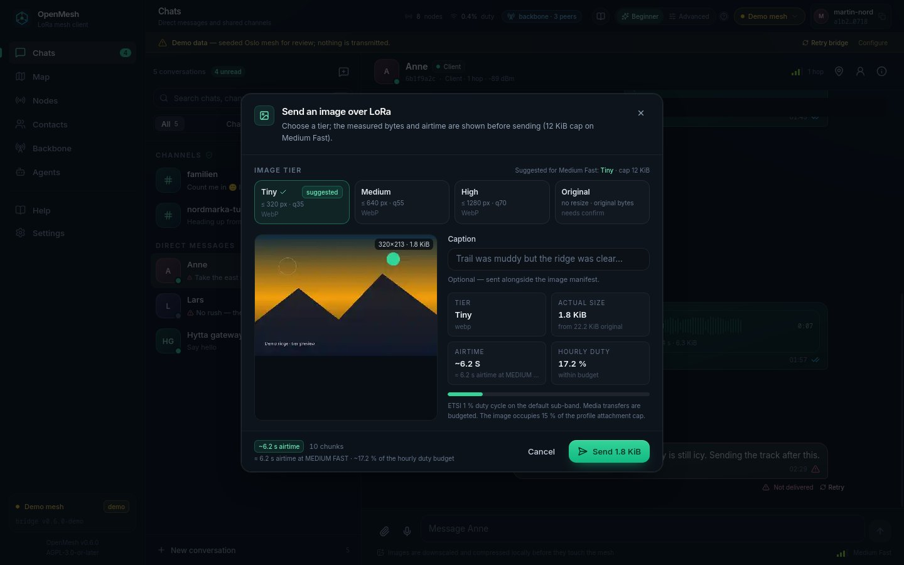 | 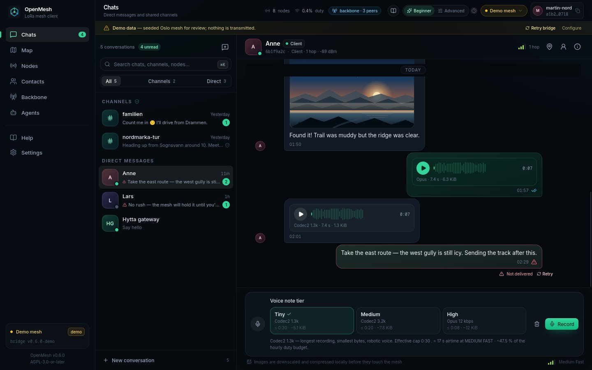 |

Guides: [images and voice notes](content/help/media.md) ·
[media tiers contract](docs/design/media-tiers.md) ·
[PROTOCOL §9.4](docs/architecture/PROTOCOL.md)

## Remote operations and gateways (v0.7)

OpenMesh is now operable **from another machine** and can bridge a mesh channel to the outside
world without a VPN full of custom code:

- **Remote MCP over HTTP (opt-in).** The bridge can expose its MCP server on its local HTTP
  listener (`/mcp`) with the bridge bearer token, **read-only by default**, existing `confirm:true`
  gating for dangerous tools, session IDs, SSE responses and rate limits. stdio remains the
  default local path; the HTTP transport is for a tunnel/VPN, never a public bind. Every write is
  audited in the activity log.
- **Gateways.** Authenticated **webhook connectors** bridge a channel to any adapter in both
  directions: outbound messages are signed `POST`s (HMAC-SHA256) with metadata; inbound calls to
  `POST /api/gateways/{id}/inbound` (also HMAC-signed) inject a text message into a configured
  channel. Secrets live in env vars only, are never stored/logged, and every connector has a test
  button, per-channel filters, retries and status. Adapters documented for Matrix, SMS providers,
  an email forwarder and satellite messengers — no vendor lock-in and no attachment bytes leave
  the mesh in v0.7.
- **Multiple backbone links.** A bridge can join several backbones at once (redundancy/failover,
  separate communities); `(src,seq)` dedup prevents loops, links have individual status/backoff,
  and legacy single-link `join` configs keep working.
- **Security posture:** loopback by default, token auth for every route, secrets via env vars,
  activity-log audit for writes, and explicit warnings that a gateway operator sees bridged
  plaintext (that leg is no longer end-to-end encrypted).

| Gateways: signed webhooks both ways | Remote MCP over HTTP (read-only default) |
| --- | --- |
| 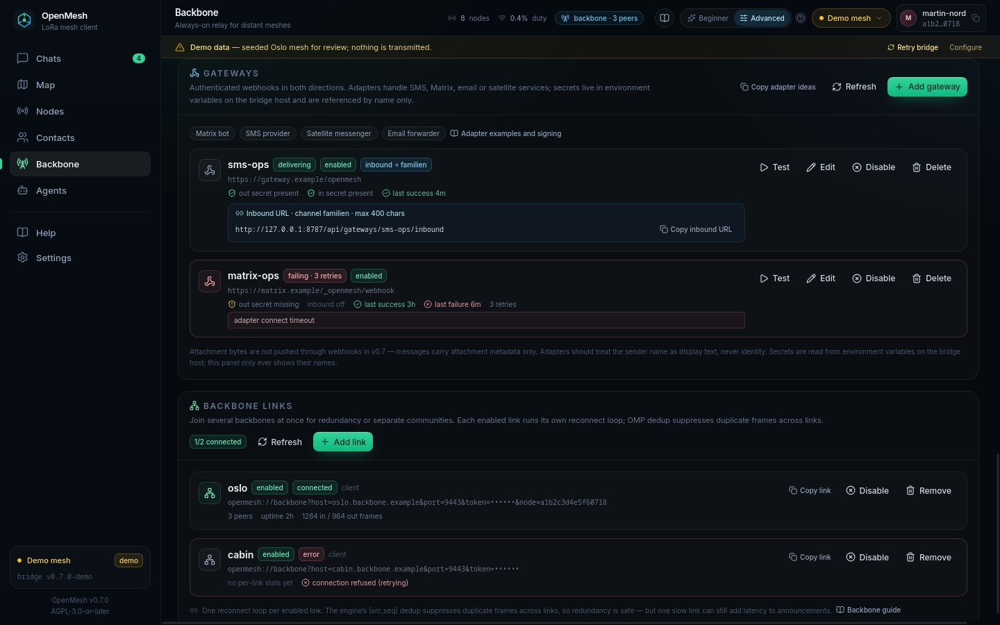 | 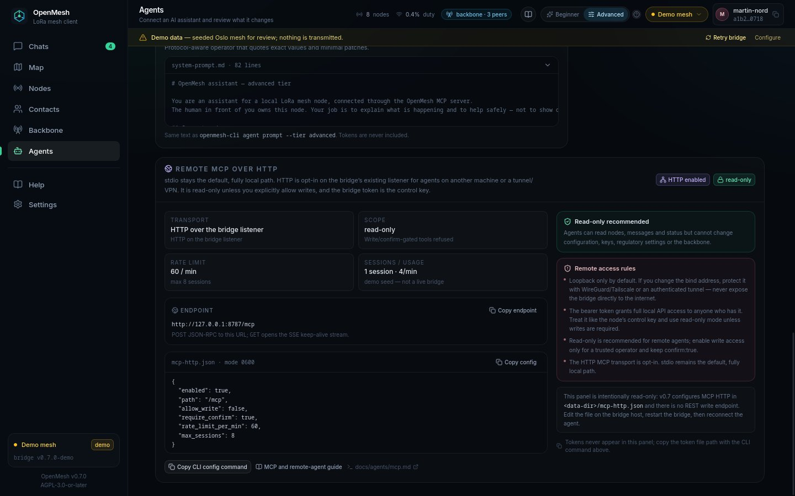 |

| Multiple backbone links |
| --- |
| 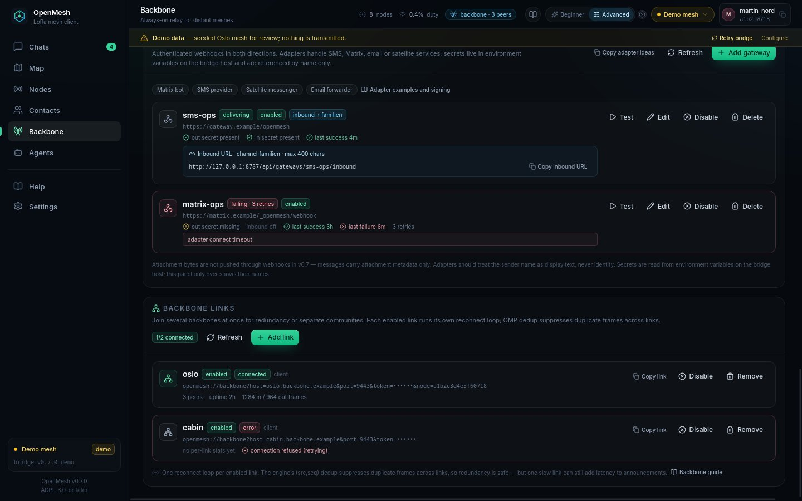 |

Guides: [remote operations](docs/guides/remote-operations.md) ·
[help: gateways and remote agents](content/help/gateways-and-remote-agents.md) ·
[ADR 0012](docs/adr/0012-remote-mcp-and-gateways.md) ·
[MCP reference](docs/agents/mcp.md)

## Repository layout

```
crates/openmesh-core     OMP/1 protocol engine: wire, crypto, resources, store-forward
crates/openmesh-bridge   Local daemon: transports, redb store, WebSocket/REST API
crates/openmesh-cli      Terminal client and diagnostics
crates/openmesh-sim      Discrete-event mesh simulator (scenarios, loss models)
crates/openmesh-ffi      UniFFI surface for native mobile clients
firmware/                PlatformIO C++17 firmware for the four reference boards
apps/web                 React 19 + MapLibre client (PWA + Tauri desktop shell)
apps/flasher             Browser flasher (esp-web-tools + UF2)
apps/android             Native Android app (Compose, BLE/USB companion)
tools/flash              Fedora/Linux flasher CLI
protocol/vectors         Golden vectors shared by Rust and firmware
docs/                    Architecture, protocol, ADRs, research, hardware
```

## Design principles

1. **Airtime is the currency.** Every feature shows its cost before you send it; repeaters
   enforce duty cycles.
2. **Relays are dumb and untrusted.** They forward and store ciphertext; they never hold keys.
3. **The core is deterministic.** No IO, no clocks, no threads: the same engine drives the
   daemon, the simulator and CI.
4. **Two implementations, one contract.** Rust core + C++ firmware, bound by golden vectors in
   `protocol/vectors`.
5. **Clients are the product.** A mesh is only as good as the app in your pocket.

## Documentation

* [Architecture overview](docs/architecture/ARCHITECTURE.md)
* [OMP/1 protocol specification](docs/architecture/PROTOCOL.md) — normative
* [Bridge WebSocket + REST API](docs/architecture/WEBSOCKET-API.md) — normative
* [Companion (radio ⇄ app) API](docs/architecture/COMPANION-API.md)
* [Backbone mode (OBB/1) — relay + control panel](docs/architecture/BACKBONE.md) · [ADR 0009](docs/adr/0009-backbone-mode.md)
* [Install guide](docs/INSTALL.md) · [Backbone deployment & operations](docs/operations/backbone-deployment.md)
* [Hardware support and flashing](docs/hardware/boards.md)
* [Quick start (beginner)](docs/QUICKSTART.md) · [Advanced cookbook](docs/guides/advanced-cookbook.md) · [Troubleshooting](docs/guides/troubleshooting.md) · [FAQ](docs/guides/faq.md) · [Glossary](docs/glossary.md)
* [AI-native control plane (MCP + prompts)](docs/agents/mcp.md) · [OpenAPI 3.1](docs/api/openapi.json)
* [AGENTS.md](AGENTS.md) · [llms.txt](llms.txt) — for coding agents working on the repo
* [ADRs](docs/adr/) · [Research](docs/research/) · [Roadmap](docs/ROADMAP.md)

## Security

OpenMesh is **alpha software and has not been audited**. The protocol provides end-to-end
encryption for messages and attachments and signature authentication for group messages, but
v1 has no forward secrecy and no traffic-analysis resistance. Do not use it as your only
lifeline. Threat model: [ARCHITECTURE.md §Security](docs/architecture/ARCHITECTURE.md#6-security-model).
Reporting vulnerabilities: [SECURITY.md](SECURITY.md).

## How this project is built

OpenMesh is **AI-assisted and human-directed**. AI tools help draft protocol code, firmware,
clients, tests and documentation; humans define the contracts, review every change, run the test
and QA gates (including real-device Android testing and firmware host-vector conformance), and own
the releases. AI output is treated as untrusted until reviewed and tested — it is not a substitute
for human judgement, and no part of this project is claimed to be "fully AI-generated". The
process and its honest limits are documented in
[docs/research/ai-development-workflow.md](docs/research/ai-development-workflow.md), and the
rules for AI involvement are in [AI-POLICY.md](AI-POLICY.md).

## Contributing

**Contributions are closed for now.** OpenMesh is developed only by the repository owner and
their designated AI assistant; pull requests from anyone else are closed automatically and
issues/discussions are disabled until contributions open. When they open, the strict
[AI contribution policy](AI-POLICY.md) and [CONTRIBUTING.md](CONTRIBUTING.md) apply: human authors
are accountable, AI involvement must be disclosed, and every change must pass the full review and
test gates.

## Acknowledgements

OpenMesh stands on the shoulders of [Reticulum](https://reticulum.network/) by Mark Qvist,
[Ratspeak](https://ratspeak.org/), [Meshtastic](https://meshtastic.org/),
[MeshCore](https://meshcore.io/), and the LoRa/Semtech community. No code from restricted
licences (including LXST) is used. See [NOTICE](NOTICE).

## Licence

[AGPL-3.0-or-later](LICENSE). If you run a modified OpenMesh node or service over a network, you
must publish your changes — the mesh stays open.
