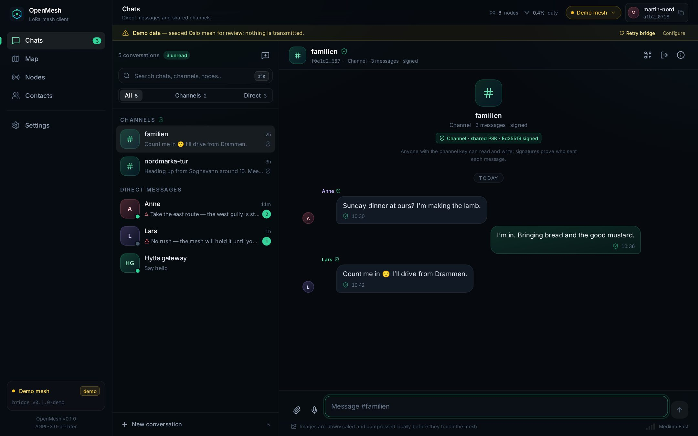
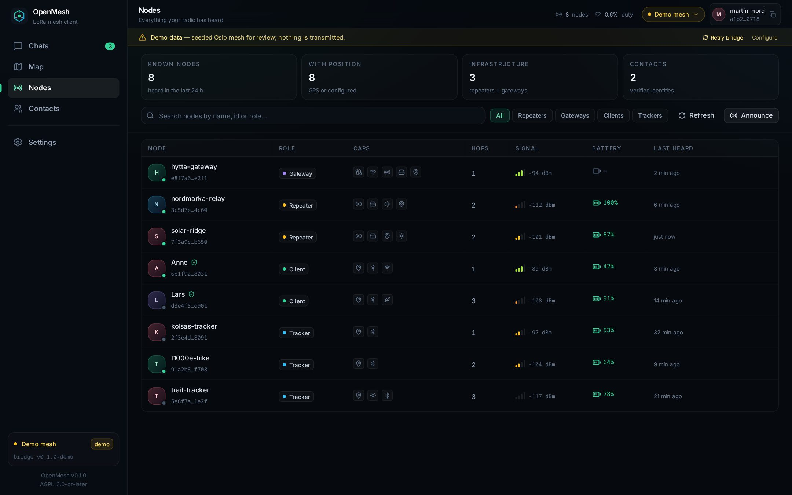
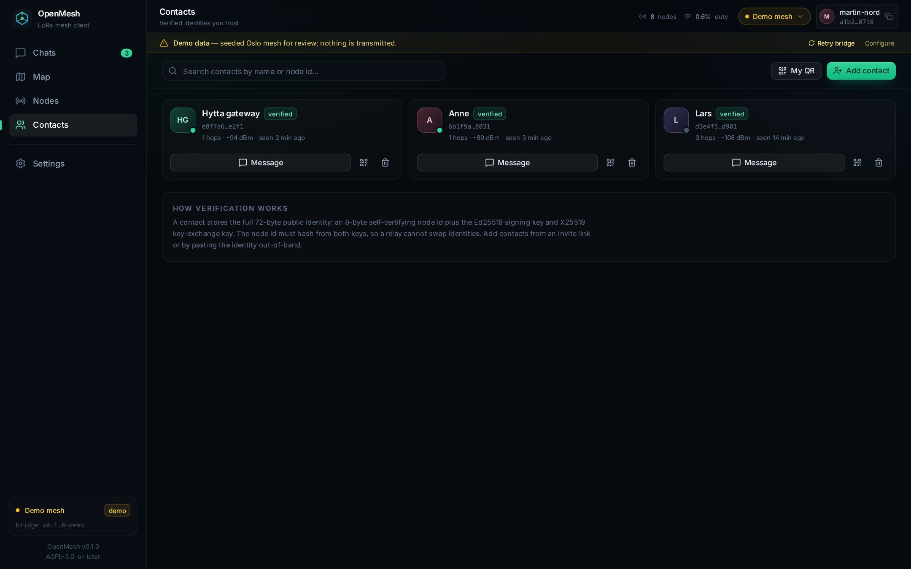
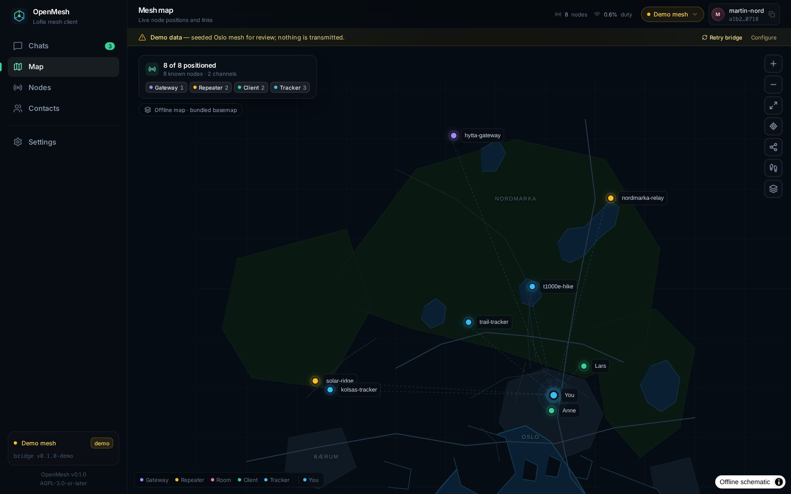

# Quick start: zero to a secure mesh in 10 minutes

You do not need to understand radios, cryptography or Linux to finish this guide. In ten minutes
you will have OpenMesh running, a secure node identity, a private channel with an invite, and a
working message — first on a simulated mesh, then (optionally) on real radios.

**What you need**

* A computer running Linux, macOS or Windows (this guide shows Linux/macOS commands; Windows notes
  are called out).
* No account, no cloud service, no hardware for the first half.
* Optional for step 7: one or two supported LoRa radios (see [hardware](../docs/hardware/boards.md)).

> Prefer the in-app version? The same path exists in the web client's **Get started** checklist and
> the in-app Help Center (`/help`). This document is the printable/long-form version.



---

## 1. Install OpenMesh (2 minutes)

Linux (x86_64) and macOS (Apple Silicon):

```sh
curl -fsSL https://github.com/martintondel02/openmesh/releases/latest/download/install.sh | sh
```

The installer downloads the release, verifies its SHA-256 checksum **before installing anything**,
and puts the bridge and CLI in `~/.local/bin`, the web app in `~/.local/share/openmesh/web`, and
creates `~/.openmesh` (data) plus `~/.config/openmesh` (API token) with owner-only permissions.

<details>
<summary>Windows, manual install, or source build</summary>

* **Windows** — download `openmesh-v0.3.0-windows-x86_64.tar.gz` from the
  [releases page](https://github.com/martintondel02/openmesh/releases), extract it (Windows 10+
  includes `tar.exe`), and run `openmesh-bridge.exe` from PowerShell. See the
  [install help topic](../content/help/install.md) or [INSTALL.md](INSTALL.md) for details.
* **Manual install** — verify the release `SHA256SUMS.txt`, extract the binary and web archives,
  copy the binaries into `~/.local/bin` and `dist/` into `~/.local/share/openmesh/web`.
* **Source build** — `cargo build --release -p openmesh-bridge -p openmesh-cli`, then
  `pnpm --dir apps/web install && pnpm --dir apps/web build`.
</details>

Check it works:

```sh
openmesh-bridge --version     # openmesh-bridge 0.3.0
```

If the command is not found, `export PATH="$HOME/.local/bin:$PATH"` (and add it to your shell
profile).

---

## 2. Try it with no hardware (2 minutes)

Start **demo mode** — a complete virtual mesh on your computer:

```sh
openmesh-bridge --demo
```

Leave that terminal running, then open <http://127.0.0.1:8787>.

You should see a seeded network: conversations, a map with nodes, contacts, and an empty Help
Center waiting for you. Demo mode uses no radio and cannot reach your real hardware, so it is safe
to click around.

> On macOS, the same command works; if Gatekeeper blocks the binary, right-click → Open or run
> `xattr -d com.apple.quarantine ~/.local/bin/openmesh-bridge`.



---

## 3. Secure your node (2 minutes)

In the app, open **Get started** (or **Settings → Security**) and press **Secure my node**.

That one action applies the beginner preset:

* creates and confirms your **node identity** (the thing that makes you *you* on the mesh);
* sets the **radio region** for your country (the legally usable frequency band);
* applies safe defaults — API stays on loopback, position sharing off, sensible announce interval;
* creates a **private channel** and gives you an invite to share;
* shows a checklist of what is done and what to do next.

The preset never changes your identity later and never enables backbone/open modes. If your
country is not recognised, it falls back to `EU868` with a visible warning — change it in
**Settings → Radio** if that is wrong.

> **Two different secrets exist.** The **API token** lets the app talk to your local bridge; it is
> stored at `~/.config/openmesh/bridge-token` (mode 0600). The **channel invite** contains a shared
> channel key. Share invites only with people you want in the channel; never share the API token or
> your `identity.key`.

---

## 4. Send your first message (1 minute)

1. Open **Chats**, pick the channel created by the wizard (or create one: **New channel**).
2. Type `hello mesh` and press send.
3. Watch the ticks:
   * single tick = transmitted by your radio/transport;
   * double tick = the recipient's bridge acknowledged delivery.
   In demo mode delivery is simulated immediately.

To talk to a specific person instead, open **Contacts → Add contact**, scan their contact QR or
paste their `openmesh://contact?…` invite, then message them directly. Direct messages are sealed
to their public key; channels use a shared key.



---

## 5. Invite someone (1 minute)

1. Open the channel → **Share invite** (copy link or show the QR).
2. Send the link over a trusted channel (in person, Signal, email — not a public forum).
3. They open **Contacts → Import invite**, paste it, and join.

You are now on the same encrypted channel. In demo mode you can simulate the second person by
running a second bridge with its own data dir and API port:

```sh
openmesh-bridge --demo --data-dir /tmp/mesh-b --listen 127.0.0.1:8788
# open http://127.0.0.1:8788 and join the invite
```

---

## 6. Know where your stuff lives (1 minute)

| What | Where | Back it up? |
| --- | --- | --- |
| Identity seed | `~/.openmesh/identity.key` (or `~/.local/share/openmesh/identity.key` by default) | **Yes — losing it loses your identity** |
| Messages, contacts, channels | `~/.openmesh/openmesh.redb` + attachments | Yes, if history matters |
| API token | `~/.config/openmesh/bridge-token` | Protect it; regenerate if leaked |
| Backbone config/token | `~/.openmesh/backbone.json` (only if backbone mode) | Yes, if running a backbone |
| Web app | `~/.local/share/openmesh/web` | No (reinstallable) |

Do this now: **Settings → Identity → Back up identity**, choose a strong passphrase, and store the
file offline. There is no account recovery; the backup is the recovery.

> Why two data paths? The installer and README examples use `~/.openmesh`; a bridge started without
> `--data-dir` uses the XDG default `~/.local/share/openmesh`. Pick one and be consistent, or always
> pass `--data-dir`.

---

## 7. Optional: go on the air with real radios

When the demo is no longer enough:

1. **Plug in / connect a radio.** Supported boards are listed in
   [docs/hardware/boards.md](../docs/hardware/boards.md). Serial radios need the `real-serial`
   build feature (`cargo build --release -p openmesh-bridge --features real-serial`).
2. **Restart the bridge without `--demo`** (and without `--sim`). On first real start it opens the
   UDP LAN transport; a USB/serial radio should appear under **Settings → Radio**.
3. **Match settings across devices.** Everyone in your group must use the same **region** (legal
   band) and **profile** (speed/range). Default `MEDIUM_FAST` is right for most people; use
   `LONG_FAST` for rural range, `SHORT_*` for dense sites.
4. **Place a repeater if needed.** Two nodes with a hill between them need a repeater on the hill.
   Flash a supported board as a repeater (class `repeater`, same region/profile) and leave it
   powered.
5. **Watch the Nodes screen** — hops, RSSI, SNR and battery tell you whether the link is healthy.
   If nobody appears, it is almost always a region/profile mismatch or no shared transport.



---

## 8. Common pitfalls (read this before asking for help)

| Symptom | Cause | Fix |
| --- | --- | --- |
| `openmesh-bridge: command not found` | `~/.local/bin` not on `PATH` | Re-open the terminal or export the path. |
| Browser: connection refused | bridge not running / wrong port | Start the bridge; check `curl http://127.0.0.1:8787/api/health`. |
| Page asks for a token | the bridge API token is required for the panel | Paste `~/.config/openmesh/bridge-token` in Settings → Bridge. |
| Nodes list empty with real radios | region/profile mismatch, radio not detected, or out of range | Match region/profile; check the radio; move closer/outdoors. |
| Message stuck at one tick | recipient offline, no store-capable relay, or TTL too small | Wait, add a store repeater, or raise TTL (advanced). |
| Image takes minutes | slow profile and/or duty-cycle budget | Send text; use a faster profile locally; wait for the budget window. |
| Invite does not work | truncated link or it is a contact link, not a channel link | Copy the full `openmesh://channel?…`; use the QR. |
| Lost identity after reinstall | no backup, or restored the wrong data dir | Restore the identity backup; otherwise create a new identity. |
| Agent 401 | API token rotated or missing in the agent config | Update `OPENMESH_TOKEN*`, restart the agent. |
| `--system` install failed | no sudo / non-interactive shell | Re-run with `--yes` as a sudo-capable user, or install as a user. |

Full playbook: [troubleshooting guide](guides/troubleshooting.md) and the in-app
[troubleshooting help topic](../content/help/troubleshooting.md).

---

## 9. Where to go next

* **Connect distant meshes** — [run a backbone](operations/backbone-deployment.md) (VPS/Raspberry Pi,
  one TCP port, WireGuard recommended on hostile networks).
* **Use an AI agent** — [MCP reference](../docs/agents/mcp.md): connect Claude/Cursor/DSH, start
  read-only, review the activity log.
* **Tune the radio** — [radios, regions and airtime](../content/help/radio-and-region.md) and the
  [advanced cookbook](guides/advanced-cookbook.md).
* **Understand the security** — [security help topic](../content/help/security.md) and
  [ADR 0003](../docs/adr/0003-static-ecdh-then-ratchet.md).
* **All terms** — [glossary](../docs/glossary.md) and the [FAQ](guides/faq.md).
