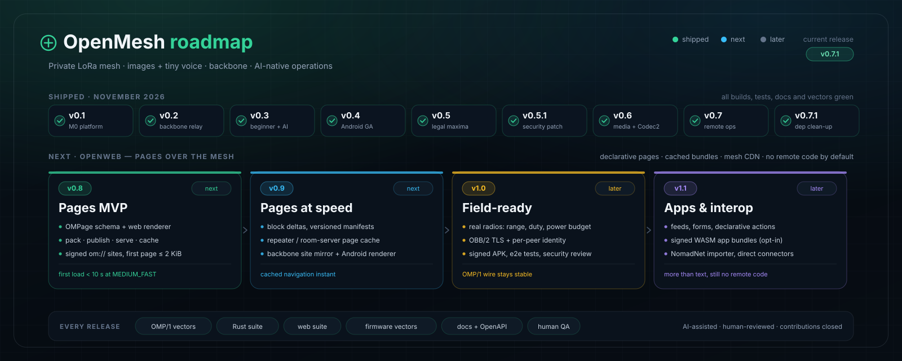

# OpenMesh roadmap

**Status:** living document · current release **v0.7.1** · last updated **2026-11-26**
**How to read it:** shipped releases are facts; future releases are intent with measurable exit
criteria. Dates are deliberately relative — a solo maintainer working with an AI agent team (DeepSeek
Harness) ships in focused increments, not calendar promises.

**Principles:** airtime is the product constraint · text → media → interop · one protocol proven by
two implementations · ship small honest increments · no fabricated benchmarks. Full detail:
[guiding principles](#1-guiding-principles) · [quality gates](#6-quality-gates) ·
[known risks](#7-risks-and-open-decisions).

---

## 1. Guiding principles

1. **Airtime is the product constraint.** Every feature is judged in seconds of channel time and
   has a UX for "too expensive" (see [capacity analysis](research/lora-capacity-and-media.md)).
2. **Text first, then media, then pages, then interop.** Do not build a browser before the mesh
   carries text reliably in the field.
3. **One protocol, proven by two implementations.** Rust core and C++ firmware replay the same
   golden vectors; wire changes require a spec edit + regenerated vectors + a migration note.
4. **Secure defaults, honest limits.** Read-only MCP unless opted in, legal-maximum radio settings,
   gateway legs clearly marked as no longer end-to-end encrypted.
5. **Ship small, test everything, disclose the AI.** AI-assisted, human-directed: AI drafts code and
   docs; humans set contracts, review every change, run gates and hardware QA, and own releases.
6. **No fabricated numbers.** Every number in docs is either measured (simulator/field, dated) or
   labelled a computed estimate.

---

## 2. Where we are — shipped

| Release | Date (UTC) | Headline | Highlights |
| --- | --- | --- | --- |
| [v0.1.0](https://github.com/martintondel02/openmesh/releases/tag/v0.1.0) | 2026-11-25 | **OMP/1 + platform** | Rust core (wire, crypto, flooding, resources, store-forward), bridge WS/REST, web PWA + demo, 4-board firmware, flashers, simulator, docs, CI |
| [v0.2.0](https://github.com/martintondel02/openmesh/releases/tag/v0.2.0) | 2026-11-25 | **Backbone mode** | OBB/1 authenticated TCP relay, control panel, join mode, installer + ops guide |
| [v0.3.0](https://github.com/martintondel02/openmesh/releases/tag/v0.3.0) | 2026-11-25 | **Beginner + AI-native** | Guided setup, beginner/advanced modes, 17-topic help corpus, stdio MCP server, OpenAPI, activity log |
| [v0.4.0](https://github.com/martintondel02/openmesh/releases/tag/v0.4.0) | 2026-11-25 | **Android GA** | On-device UniFFI engine, BLE/USB, foreground service, media/QR/notifications, public-exposure guidance |
| [v0.5.0](https://github.com/martintondel02/openmesh/releases/tag/v0.5.0) | 2026-11-26 | **Legal maxima** | Per-region legal defaults (EU868/EU433 first), warning-gated duty/power/frequency override across core, firmware, bridge, web, Android |
| [v0.5.1](https://github.com/martintondel02/openmesh/releases/tag/v0.5.1) | 2026-11-26 | **Security patch** | Dependency and map-stack security updates; open alerts 8 → 0 |
| [v0.6.0](https://github.com/martintondel02/openmesh/releases/tag/v0.6.0) | 2026-11-26 | **Media tiers + tiny voice** | Tiny/Medium/High/Original images, Codec2 1.3/3.2 kbps + Opus voice, shared tier table, WASM/Android/desktop codec, measured airtime previews, device QA |
| [v0.7.0](https://github.com/martintondel02/openmesh/releases/tag/v0.7.0) | 2026-11-26 | **Remote operations** | Opt-in MCP over HTTP (read-only default), signed webhook gateways both ways, multiple backbone links |
| [v0.7.1](https://github.com/martintondel02/openmesh/releases/tag/v0.7.1) | 2026-11-26 | **Dependency maintenance** | Tailwind 4, `@types/node` 26, Dependabot policy; zero open dependency PRs |

**Today:** 291 Rust tests · 288 web tests · 77 Android tests · 51 firmware host cases (3,639
assertions) · golden vectors byte-identical since v0.5. Everything above is released, verified and
documented; Android and web artifacts are built by CI on every tag, and device QA covers the radio
override and media paths.

---

## 3. North star and non-goals

**North star:** a private, self-hosted mesh you can actually live with — text, images, tiny voice,
location, pages and AI agents — connected by store-and-forward repeaters and an internet backbone,
without a cloud account in the middle.

**In scope**
- Reliable text mesh with store-and-forward, legal region defaults and honest airtime costs.
- Media that fits the channel (Codec2 voice, tiered images) instead of pretending bandwidth exists.
- Human UX and AI-native operations (MCP, gateways, activity audit) as first-class features.
- Interop where it is concrete and licensed-compatible (NomadNet/Reticulum later, not by breaking OMP/1).

**Deliberately not doing**
- Browsing the regular web over LoRa or running arbitrary remote JavaScript by default.
- A cloud service, proprietary clients, or silent telemetry.
- Vendor SDK lock-in for gateways (signed webhooks + adapters instead).
- Restricted licences (LXST/rsLXST are explicitly avoided — see [NOTICE](../NOTICE)).

---

## 4. Next: OpenWeb — pages over the mesh (v0.8 → v1.1)

The next product arc is **mesh-native pages and small web apps**: NomadNet-style publishing, but
better looking, faster after first load, and capable of more than text.

### 4.1 The idea in one paragraph

Don't stream HTML/CSS/JS per page over a 240-byte, duty-cycled channel. Ship a **tiny declarative
page document (OMPage)** that a **local renderer** turns into a beautiful native/React view; ship the
site once as a **signed, content-addressed bundle** that clients and repeaters **cache**; then sync
only **small data deltas and actions**. Presentation ships with the client (design system, fonts,
icons); payload is mesh data. That is how "pretty" and "fast" coexist with LoRa airtime.

### 4.2 Architecture

| Layer | What is added |
| --- | --- |
| `openmesh-core` | `pages` service schema (CBOR) on top of existing resources/ARQ; **no frame/wire change**, vectors untouched |
| Bridge | Bundle store, publish/serve/cache API, version manifests, WS/REST events, site-mirror gateway (backbone → mesh) |
| Web / Android / TUI | OMPage renderer, local site cache, address bar + catalog; shared design tokens; renderer parity tests |
| CLI | `pages pack`, `publish`, `serve`, `browse`, `validate`; authoring SDK emits OMPage |
| Repeaters / room servers | Opt-in page cache (LRU + flash quota), store-forward reads, nearest-cache answers |
| Backbone | Fetch/prime bundles over internet, mirror mode, TTL/version tracking (TLS with OBB/2, v1.0) |
| MCP / AI | `pages_publish`, `pages_get`, `pages_cache`, `pages_mirror`; AI-assisted authoring |
| Docs | `PAGES.md` spec + ADR-0013 (planned), help topic "Pages and sites", operator guide |

### 4.3 Targets (measured, not promised)

| Metric | Target |
| --- | --- |
| First page | ≤ 2 KiB, first load < 10 s at `MEDIUM_FAST` (≈ 3 s at `SHORT_FAST`) |
| Small site bundle | ≤ 8–16 KiB, fetched once and cached |
| Cached navigation | instant (0 airtime) |
| Typical update (status, post, sensor) | 100–800 B delta |
| Renderer parity | web + Android render the same schema (golden page fixtures) |
| Safety | no remote code by default; signed manifests; explicit actions only |

### 4.4 Milestones

#### v0.8 — Pages MVP *(next; 2–3 focused weeks)*

- Contract first: `docs/design/pages.md` + ADR-0013; OMPage JSON/CBOR schema; versioned, signed
  manifests; content-addressed block IDs.
- Web renderer (design-system components), site browser (`om://<site-key>/<page>`), local cache,
  publish/pack/serve/cache in bridge + CLI, offline reading, help topic + operator guide.
- Exit criteria: publish a 3–5 page site from the CLI; read it on web over `MEDIUM_FAST` in <10 s
  first load; instant cached navigation; signed manifest verified; golden page fixtures render
  identically in tests; no wire change.

#### v0.9 — Pages at speed *(2–4 focused weeks)*

- Block-level deltas and version manifests; repeater/room-server page cache with quotas and LRU;
  backbone site mirror (URL → sanitized OMPage, clearly labelled); Android Compose renderer parity;
  site catalog/announce; image tiers in bundles; profile-aware "load images" affordances.
- Exit criteria: typical update <1 KiB; cached page survives site offline; two clients render the
  same site; cache quotas enforced on a flash-constrained board; mirroring is opt-in and audited.

#### v1.0 — Field-ready *(dependent on hardware; 4–8 weeks elapsed)*

- Real-radio field validation: range/profile/duty, text + ack, media round-trip, store-forward via
  repeater, backbone + Openflare, power budget — the honest gate before "recommended for real use".
- OBB/2: native TLS + per-peer identity, reviewed handshake, migration note.
- Signed Android release APK (keystore secrets), F-Droid/Play readiness, Playwright end-to-end tests,
  identity backup/export UX, external security review.
- Exit criteria: field report with measured numbers and dated limitations; reproducible signed
  release; e2e suite in CI; security review findings triaged and fixed.

#### v1.1 — Apps & interop *(2–4 focused weeks)*

- Feeds, forms and declarative actions; optional **signed WASM app bundles** with a capability-scoped
  sandbox (opt-in, high-bandwidth links only); NomadNet/Micron importer; direct Matrix/email
  connectors on top of the gateway framework; richer charts/tables.
- Exit criteria: an interactive checklist/board app works offline-first from a cached bundle; WASM
  apps are signed, sandboxed and clearly labelled; NomadNet content imports into OMPage without
  hand editing.

### 4.5 Dependency sketch

---

## 5. Later horizon

| Horizon | Theme | Notes |
| --- | --- | --- |
| **OMP/2** | Forward secrecy (ratchets), optional directed routing, gated voice calls | Wire version change: vectors + 6-month migration window; after v1.0 field data |
| **Interop** | Reticulum/NomadNet bridge, Meshtastic text gateway | Concrete adapters with licence review; no protocol compromises in OMP/1 |
| **Scale** | Room servers, multi-channel radios, network map API | Depends on stable field mesh and identity registry |
| **Clients** | iOS, desktop polish, F-Droid/Play | Android first; iOS reuses the shared engine where practical |

---

## 6. Quality gates

Every release must pass the same gates; a release is not cut from a red tree.

| Gate | Command / surface | Current |
| --- | --- | --- |
| Format + lint | `cargo fmt --all -- --check`, `cargo clippy --workspace --all-targets -- -D warnings` | green |
| Rust tests | `cargo test --workspace --all-targets` | 291 |
| Web | `pnpm --dir apps/web build`, `pnpm test` | 288 tests, 0 TS errors |
| Android | lint + `testDebugUnitTest` + `assembleDebug` | 77 tests, clean |
| Firmware | host tests replaying protocol vectors | 51 cases / 3,639 assertions |
| Wire contract | regenerated golden vectors + drift check | byte-identical |
| Docs | `check_docs.py`, `check_help.py`, `check_openapi.py` | green (18 help topics) |
| Release | CI, Android, Firmware, CodeQL, Release workflows + assets + SHA256SUMS | green |
| Human QA | device pass for radio/media/remote-ops changes | recorded per release |

**How work ships:** contract/ADR first → tests → implementation → docs/help → CI gates → human
review/device QA → release notes. Contributions are closed for now (auto-close workflow); the
[AI policy](../AI-POLICY.md) applies to every change, including the owner's agents.

---

## 7. Risks and open decisions

| Risk / decision | Impact | Mitigation / next step |
| --- | --- | --- |
| **No radios on the build host** | Field validation (#4) cannot finish | Hardware-dependent v1.0 gate; simulator + device BLE/USB QA until boards arrive |
| **Signed APK needs keystore secrets** | Store-ready Android blocked | Owner supplies keystore secrets; CI signing path is already wired |
| **Pages schema ownership** | Renderer drift across web/Android/TUI | One normative schema + golden page fixtures; ADR-0013 before v0.8 code |
| **Cache quotas on repeaters** | Flash wear / storage exhaustion | Opt-in per-site cache, LRU, hard quotas, size telemetry; never cache private pages silently |
| **Mirrored internet content** | Copyright, privacy, stale content | Opt-in mirroring, provenance labels, sanitization, no silent rehosting |
| **Remote code in pages** | XSS/escape risk | Declarative-only default; WASM apps signed, sandboxed, capability-scoped, clearly labelled |
| **OBB/2 TLS + identity** | Backbone trust model | Dedicated design + external review in v1.0; TLS 1.3 + per-peer keys, migration note |
| **Deferred Rust majors** | Dependency drift over time | Dependabot groups minor/patch; majors get a dedicated crypto/wire/FFI migration task |
| **Single-maintainer bus factor** | Delivery risk | Contracts, docs, CI gates, release automation, open source |

**Decisions we need to make soon**
1. OMPage schema details (components, actions, feeds) and renderer parity policy.
2. Bundle size caps and cache quota defaults per board class.
3. Mirroring policy (what may be fetched/rehosted, labelling, takedown path).
4. Whether pages are served from bridge, room server, repeater or all (cache placement).
5. WASM app sandbox threat model before v1.1.

---

## 8. Versioning and release train

- **Semantic versions:** patch = fixes/deps/docs only; minor = features without wire changes; major
  wire changes require `PROTO_VERSION`, regenerated vectors and a migration window.
- **OMP/1 stays stable through v1.x**; OMP/2 is a separate, reviewed transition.
- **Small, frequent releases** with full assets (Linux/macOS/Windows, web bundle, Android APK,
  `install.sh`, `SHA256SUMS.txt`) and honest release notes.
- **AI disclosure:** releases and docs state AI-assisted/human-directed QA; never "100% AI-built".

---

## 9. Links

[Architecture](architecture/ARCHITECTURE.md) · [Protocol](architecture/PROTOCOL.md) ·
[Backbone](architecture/BACKBONE.md) · [AI-native](architecture/AI-NATIVE.md) ·
[Media tiers](design/media-tiers.md) · [Remote operations](design/remote-operations.md) ·
[ADRs](adr/) · [Research](research/) · [Help corpus](../content/help/) ·
[AI policy](../AI-POLICY.md) · [Changelog](../CHANGELOG.md) ·
[Releases](https://github.com/martintondel02/openmesh/releases)

*This roadmap is the intent; the repository's gates and release notes are the truth. If you are
reading this after a later release, check the [CHANGELOG](../CHANGELOG.md).*
